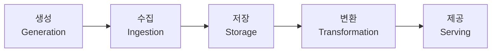
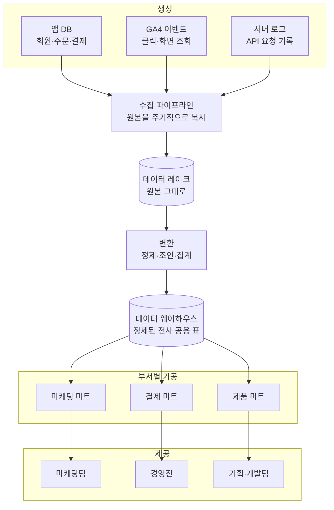
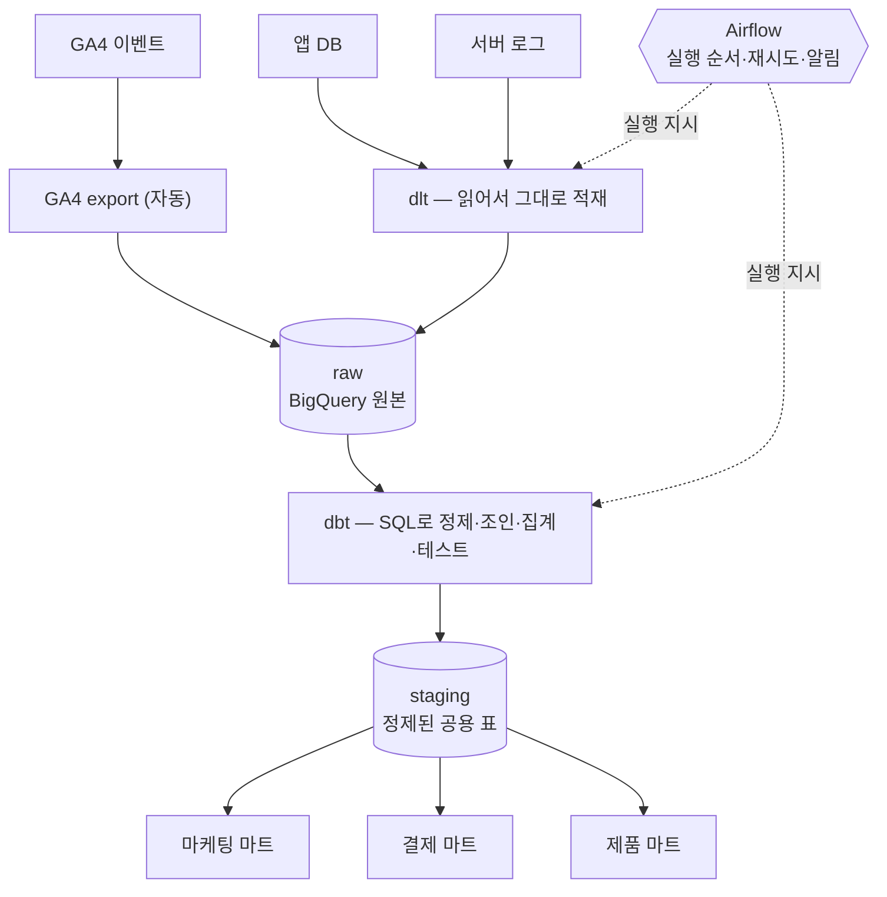
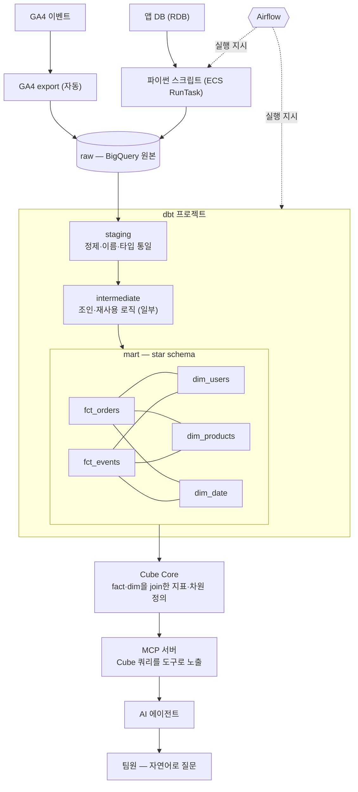
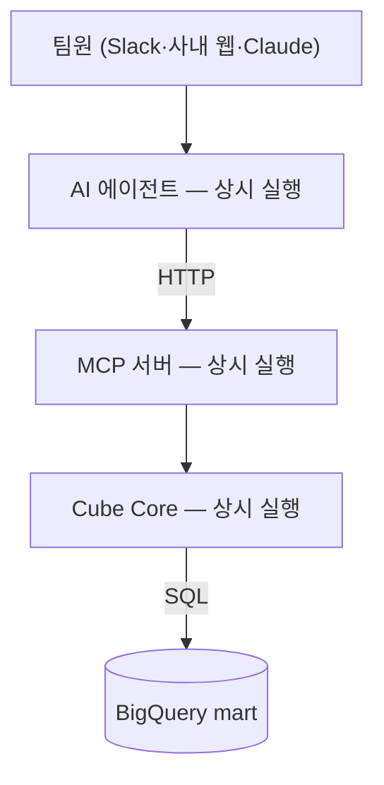
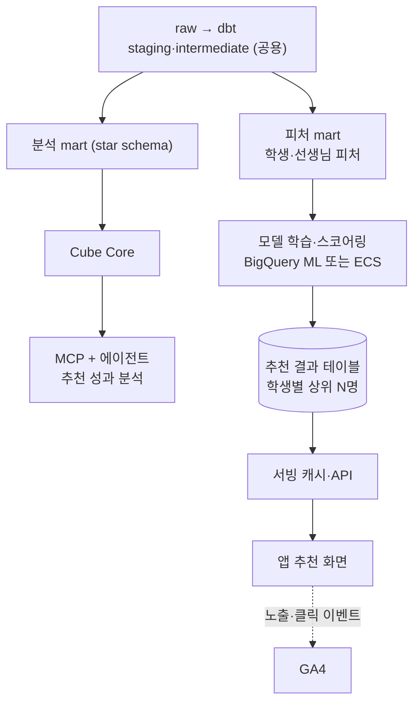
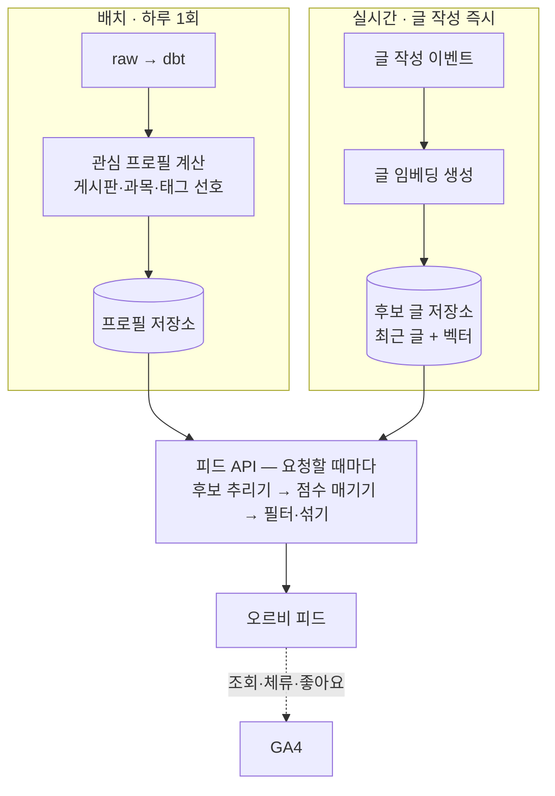

# 데이터 엔지니어링 전체 구조 정리

> 『데이터 엔지니어링의 기초』(Joe Reis, Matt Housley) 1장을 읽고, 우리 데이터 플랫폼에 대입해 본 내용

## 1. 데이터 엔지니어링이란

원본 데이터를 모아서, 분석가·데이터 과학자·ML·에이전트가 바로 쓸 수 있는 **믿을 만한 데이터로 만들어 주는 시스템**을 짓고 운영하는 일.

### 데이터 엔지니어링 라이프사이클

모든 단계에 걸쳐 신경 써야 하는 **저류(undercurrents)**: 보안, 데이터 관리, DataOps, 데이터 아키텍처, 오케스트레이션, 소프트웨어 엔지니어링

### 역사 한 줄 요약

| 시기 | 키워드 |
|---|---|
| 1980~2000 | 데이터 웨어하우스, BI, SQL |
| 2000년대 초 | 구글 GFS·MapReduce 논문 → 하둡, AWS 등장 |
| 2000~2010년대 | 빅데이터 엔지니어 (하둡·스파크·카산드라 직접 운영) |
| 2020년대 | 관리형 클라우드 도구 → "그냥 데이터 엔지니어", 거버넌스·품질 중심 |

- **하둡**: 큰 파일을 여러 컴퓨터에 쪼개 저장(HDFS) + 나눠서 계산(MapReduce). 디스크 기반이라 느림
- **스파크**: 하둡과 같은 분산 처리지만 메모리 기반이라 훨씬 빠름. 지금도 주력
- **카산드라**: 분산 NoSQL DB. 분석용이 아니라 대량 쓰기가 필요한 서비스용 저장소
- **BigQuery**: 이런 분산 처리를 구글이 뒤에서 대신 해 주는 관리형 서비스

---

## 2. 레이크 · 웨어하우스 · 마트

| | 데이터 레이크 | 데이터 웨어하우스 | 데이터 마트 |
|---|---|---|---|
| 비유 | 물류창고 (상자째 쌓아 둠) | 대형마트 매장 (정리된 진열대) | 마트 안 코너 (음료 코너) |
| 담는 것 | 원본 그대로, 모든 형식 | 정제된 공용 표 | 특정 팀이 자주 보는 것만 |
| 스키마 | 읽을 때 정함 | 넣을 때 정함 | 넣을 때 정함 |
| 예 | GCS, S3, BigQuery raw | BigQuery, Snowflake | BigQuery mart 데이터셋 |

### 전체 흐름

### 앱 DB에 바로 쿼리하면 안 되는 이유

| | 앱 DB (OLTP) | 웨어하우스 (OLAP) |
|---|---|---|
| 목적 | 서비스 운영 | 분석 |
| 잘하는 일 | 한 줄을 빠르게 읽고 쓰기 | 수백만 줄을 한 번에 집계 |
| 무거운 쿼리를 돌리면 | 앱이 느려지거나 장애 | 원래 그러라고 있는 곳 |

---

## 3. 수집 · 변환 · 오케스트레이션

- 수집과 변환은 **항상 떠 있는 서버가 아니라, 정해진 시간에 돌고 끝나는 잡(job)**
- **수집**: 원본을 읽어서 그대로 넣기 (주로 파이썬 스크립트, 또는 도구)
- **변환**: 웨어하우스 안에서 SQL로 다듬기 (ELT가 요즘 대세)
- **오케스트레이션**: 언제, 어떤 순서로 돌릴지 정하는 알람시계 겸 감독

| 단계 | 대표 도구 |
|---|---|
| 수집 | Fivetran(관리형), Airbyte(오픈소스), dlt(파이썬 라이브러리), GA4 BigQuery export |
| 변환 | dbt, Dataform, BigQuery 예약 쿼리 |
| 오케스트레이션 | Airflow(Cloud Composer), Dagster, Prefect, GitHub Actions, cron |

- ETL: 추출 → 변환 → 적재 (밖에서 가공 후 넣음)
- ELT: 추출 → 적재 → 변환 (일단 넣고 웨어하우스 안에서 SQL로 가공)
- 2026년 6월 Fivetran과 dbt Labs 합병 완료

### dlt + dbt + Airflow 구조

- Airflow는 데이터를 직접 옮기지 않고 **실행 지시만** 내림
- DAG로 의존 관계 정의, 실패한 작업만 재시도, 백필, 센서(조건 대기), 웹 UI 모니터링
- 작업이 몇 개 안 되면 GitHub Actions + cron으로 충분

---

## 4. 우리 데이터 플랫폼

- 수집: RDB는 파이썬 스크립트를 **Airflow + ECS RunTask**로 실행, GA4는 BigQuery export
- 변환: **dbt**로 staging → intermediate(일부) → mart
- mart: **star schema** (fact / dimension 분리, 정의 재사용)
- 시맨틱 레이어: **Cube Core**
- 제공: **MCP 서버 + AI 에이전트**

- **conformed dimension**: 여러 fact가 같은 dimension을 공유 → "신규 가입자" 같은 정의가 한 곳에만 존재
- 에이전트가 SQL을 직접 짜지 않고 Cube의 정의를 거치므로, 누가 어떻게 물어도 같은 숫자가 나옴
- dlt 도입을 검토 중: Airflow + ECS 구조는 그대로 두고, 컨테이너 안 스크립트만 dlt로 교체
  - 증분 적재 상태를 BigQuery에 저장해서 무상태인 ECS 태스크와 잘 맞음
  - 스키마 자동 추론·변경 대응, merge(upsert), load job 기반 적재

---

## 5. MCP 서버는 어디에 떠 있어야 하나

| | stdio (로컬) | Streamable HTTP (원격) |
|---|---|---|
| 실행 위치 | 사용자 컴퓨터 | 서버 (ECS Service, Cloud Run 등) |
| 누가 켜나 | 클라이언트가 자식 프로세스로 실행 | API 서버처럼 상시 실행 |
| 적합한 경우 | 개인용 도구 | 팀이 같이 쓰는 사내 도구 |

- 수집·dbt는 **잡**(돌고 꺼짐), MCP·Cube·에이전트는 **서비스**(계속 켜져 있음)
- ECS라면 RunTask가 아니라 ECS Service로 띄움

---

## 6. 같은 구조를 추천 시스템에 적용하면

### 과외 추천 (선생님 추천)

- 앞쪽 파이프라인과 dimension은 그대로 재사용, **서빙 경로만 새로**
- 양면 시장: 신청 수가 아니라 **매칭 성사**를 목표 지표로
- 유료 노출(하이프 배너)과 개인화 추천 슬롯은 분리
- 규칙 기반 → 콘텐츠 기반 → 협업 필터링 순으로 발전

### 오르비 게시글 개인화 (배치 + 실시간)

- 게시글은 계속 쏟아지고 금방 묵기 때문에 **배치만으로는 부족**
- 신선도, 필터 버블 방지, 신고·블라인드 필터를 먼저 적용
- 체류 시간이 좋아요보다 정직한 신호
- 1단계는 임베딩 없이 "선호 게시판 인기글 + 전체 인기글" 혼합부터
