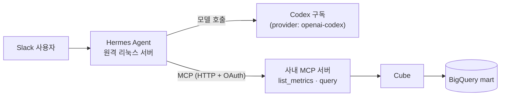

# Hermes Agent로 지표 조회 봇 붙이기 — 트러블슈팅

> 사내 시맨틱 레이어(Cube) 위의 MCP 서버를 Hermes Agent에 연결해 Slack 지표 조회 봇을 만드는 중, 원격 리눅스 서버(브라우저 없음)에서 설정하며 막힌 지점들

## 전체 구조



## 1. Codex 로그인이 "Waiting for sign-in..."에서 안 넘어감

- **증상**: 설정 마법사가 기기 코드를 보여 주고 멈춰 있음
- **원인**: 멈춘 게 아니라 **사람이 승인하기를 기다리는 중**. 기기 코드(device code) 방식은 Hermes가 혼자 진행하지 않는다
- **해결**: 아무 기기(맥북·휴대폰)의 브라우저에서 기기 인증 페이지를 열고, Codex 구독이 있는 ChatGPT 계정으로 로그인한 뒤 코드를 입력
- **배운 점**: 기기 코드 방식은 **로그인하는 기기와 코드를 받는 기기가 달라도 되도록** 만든 방식이다. 원격 서버에 브라우저가 없어도 포트 포워딩 없이 된다

## 2. Codex 설정에서 가져온 MCP 서버에 인증 설정이 빠짐

- **증상**: `config.yaml`에 `url`만 있고 인증 설정이 없음
- **원인**: Codex CLI 설정 가져오기가 `url`만 옮겼다. 인증 방식은 옮겨지지 않음
- **해결**: 직접 한 줄 추가 (들여쓰기는 공백, `url`과 같은 깊이)

```yaml
mcp_servers:
  semantic:
    url: https://<mcp-server>/mcp
    auth: oauth
```

- **배운 점**: 가져오기(import) 결과는 반드시 파일을 열어 확인한다 — 마법사가 "성공"이라고 해도 필드가 빠질 수 있다

## 3. MCP 로그인을 어떻게 시작하는지 모름

- **증상**: Hermes를 실행해도 MCP 서버가 `configured`로만 나오고 로그인 URL이 안 뜸. 채팅에서 `/mcp`를 쳤더니 `Unknown command`
- **원인**: Hermes는 MCP OAuth를 **CLI 하위 명령**으로 시작한다. 채팅 슬래시 명령이 아니다 (추측으로 명령을 알려 준 게 실수 — 공식 문서를 먼저 찾아봤어야 했다)
- **해결**

```bash
hermes mcp login <server>   # OAuth 시작
hermes mcp test <server>    # 연결·도구 목록 확인
```

## 4. 브라우저 없는 서버에서 OAuth 콜백 받기

- **문제**: OAuth 로그인이 끝나면 브라우저가 `http://127.0.0.1:<포트>/callback`으로 돌아간다. 이 주소는 **Hermes가 떠 있는 원격 서버**에서만 받을 수 있는데, 로그인은 맥북 브라우저에서 한다
- **해결 (붙여넣기 방식, 가장 쉬움)**
  1. `hermes mcp login <server>`가 출력한 URL을 맥북 브라우저에서 연다
  2. 로그인하면 브라우저가 `127.0.0.1:<포트>/callback?code=...&state=...`로 가며 **"연결할 수 없음" 에러 — 정상이다**
  3. 그 주소창 URL 전체를 원격 터미널 프롬프트에 붙여넣는다
- **다른 방법**: 맥북에서 SSH 포트 포워딩을 먼저 열면 리다이렉트가 그대로 원격까지 간다

```bash
ssh -N -L <포트>:127.0.0.1:<포트> <user>@<host>
```

- **주의**
  - 터미널에서 화살표 키를 누르면 입력 줄에 `^[[B^[[A`가 들어간다 — 붙여넣기 전에 `Ctrl+U`로 비운다
  - 붙여넣는 `code`는 일회용·PKCE로 보호되지만 계정 정보가 담겨 있다. 원격 터미널에만 붙이고 채팅·메신저에 붙이지 않는다
  - 서버가 지원하지 않으면 `--flow device`(MCP 쪽 기기 코드 방식)는 못 쓴다

## 5. 배너의 "Nous Research"가 provider처럼 보임

- **증상**: 시작 배너에 `gpt-6.1-sol · Nous Research` — Codex가 아니라 Nous Portal에 붙은 건가 의심
- **확인**

```bash
hermes config | grep -iE 'provider|model'
# provider: openai-codex, base_url: https://chatgpt.com/backend-api/codex
```

- **결론**: provider는 의도대로 Codex. 배너의 이름은 Hermes를 만든 곳 표시였다. **화면 문구보다 설정값을 본다**

## 6. 지표를 물었는데 봇이 MCP 도구를 아예 안 씀 (핵심)

- **증상**: "어제 일별 활성 사용자 수 알려줘" → `list_metrics`를 부르지 않고 skill 목록만 훑은 뒤 "어떤 데이터 소스(GA4, Amplitude, 내부 DB)를 볼까요?"라고 되물음
- **처음 한 대응 (잘못)**: Hermes의 페르소나 파일 `~/.hermes/SOUL.md`에 "먼저 list_metrics를 불러라, 답에 기간을 적어라…" 같은 조회 절차를 길게 적음
- **다시 보니**: 그 절차는 **MCP 서버가 이미 연결 시점에 지침(`instructions`)으로 보내고 있었다**. 같은 규칙을 두 곳에 두면 한쪽만 고쳐질 때 어긋난다 — 실제로 문구가 벌써 달랐다
- **진짜 원인**: 서버의 지침과 도구 설명에 "지표 조회 도구다"만 있고 **어떤 데이터(어느 서비스의 회원·활동 사용자 등)를 다루는지**가 없었다. 모델은 "DAU"라는 질문과 이 도구를 연결하지 못했다
- **비유**: 자료실(MCP 서버) 문에 "자료실" 팻말만 있으면, 새 직원(에이전트)은 DAU 자료가 거기 있는지 몰라 들어가 보지도 않는다. 책(Cube 지표 정의)이 아무리 좋아도 펼쳐지지 않는다

### 정보를 어디에 둘 것인가

| 위치 | 담을 것 | 누가 읽나 |
|---|---|---|
| Cube `description` | 지표 하나하나의 정의 | `list_metrics`를 호출한 에이전트 |
| MCP 서버 지침 + 도구 설명 | **다루는 데이터 범위**, 조회·답변 규칙 | 이 서버에 붙는 모든 에이전트 (Hermes, Claude, Codex…) |
| `SOUL.md` | 이 봇만의 역할 — "지표 조회 봇이다, 다른 도구는 쓰지 마라" | 이 Hermes 봇만 |

- **배운 점**: 에이전트가 도구를 안 쓰면 먼저 **"도구 설명만 보고 이 질문에 쓸 도구라고 알 수 있나?"**를 본다. 고칠 곳은 대개 도구를 제공하는 쪽이고, 그래야 모든 클라이언트가 같이 좋아진다

## 그 외 메모

- 설정 마법사에서 게이트웨이 자동 시작에 `n`을 답해도 systemd 서비스 파일은 만들어지고 linger(SSH 로그아웃 뒤에도 유지)가 켜진다. 시작·자동 시작은 안 된 상태
- 원격 서버에서 직접 쓰는 CLI에는 file·terminal·skills 도구가 켜져 있다. Slack용 도구 설정은 `hermes tools`에서 플랫폼별로 따로 끈다

## 다음 할 일

- [ ] `SOUL.md`를 역할만 남기고 줄인 뒤 같은 질문으로 재시험 — 답에 쓴 measure 이름과 기간(from~to)이 나오면 서버 지침이 모델까지 전달되는 것
- [ ] MCP 서버 지침·`list_metrics` 설명에 다루는 데이터 범위 추가 (사내 repo PR)
- [ ] Slack 앱 생성 → 토큰 등록 → Slack 플랫폼은 MCP만 남기고 도구 끄기
- [ ] 봇이 개인 계정으로 MCP에 로그인한 상태 — 운영 전 봇 전용 계정으로 바꿀지 결정
