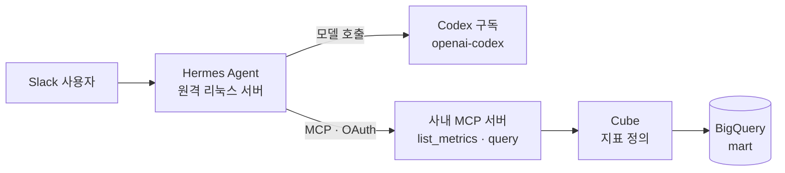
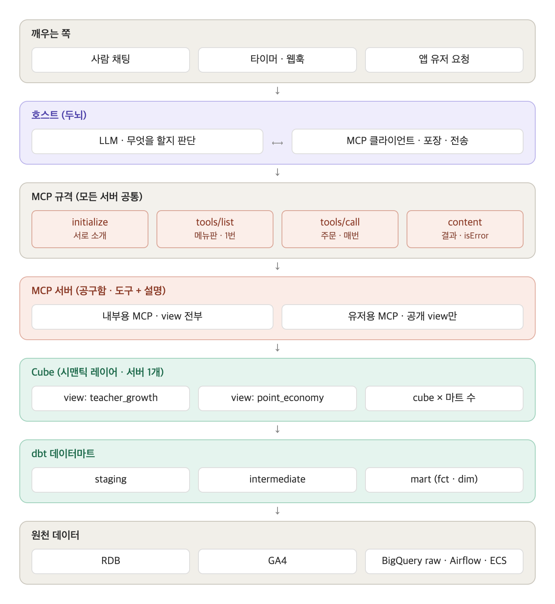
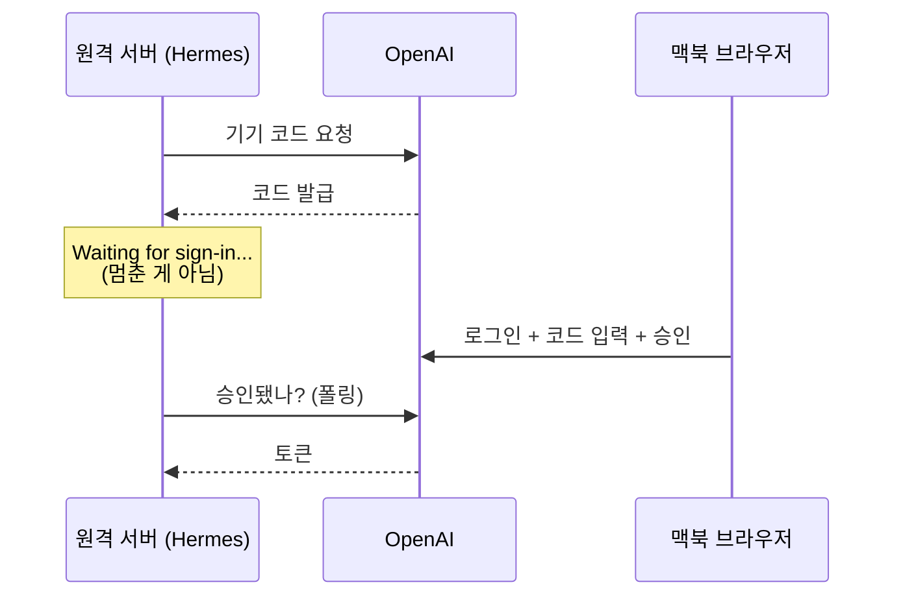
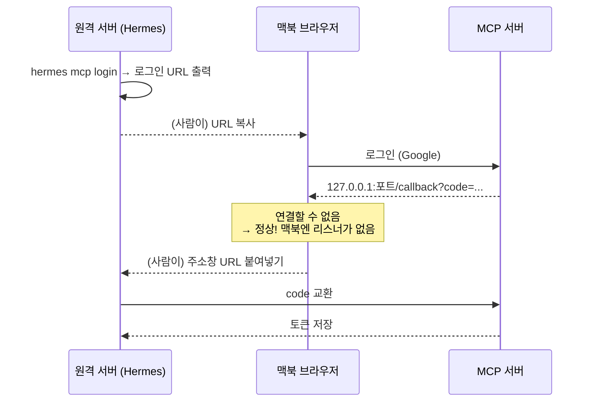
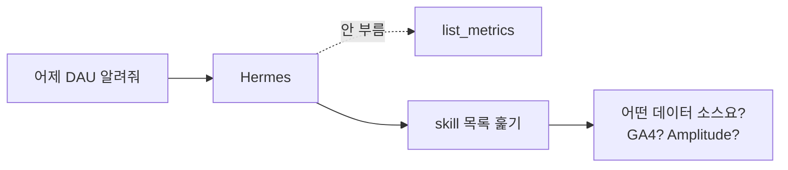
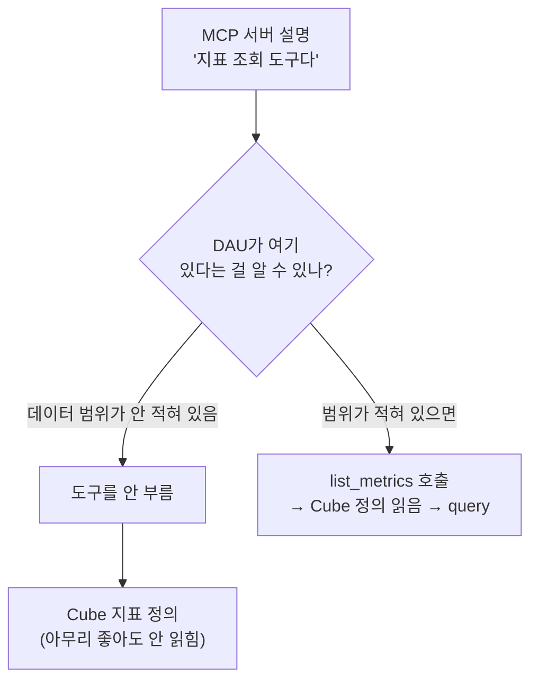
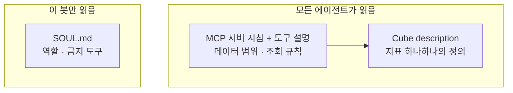
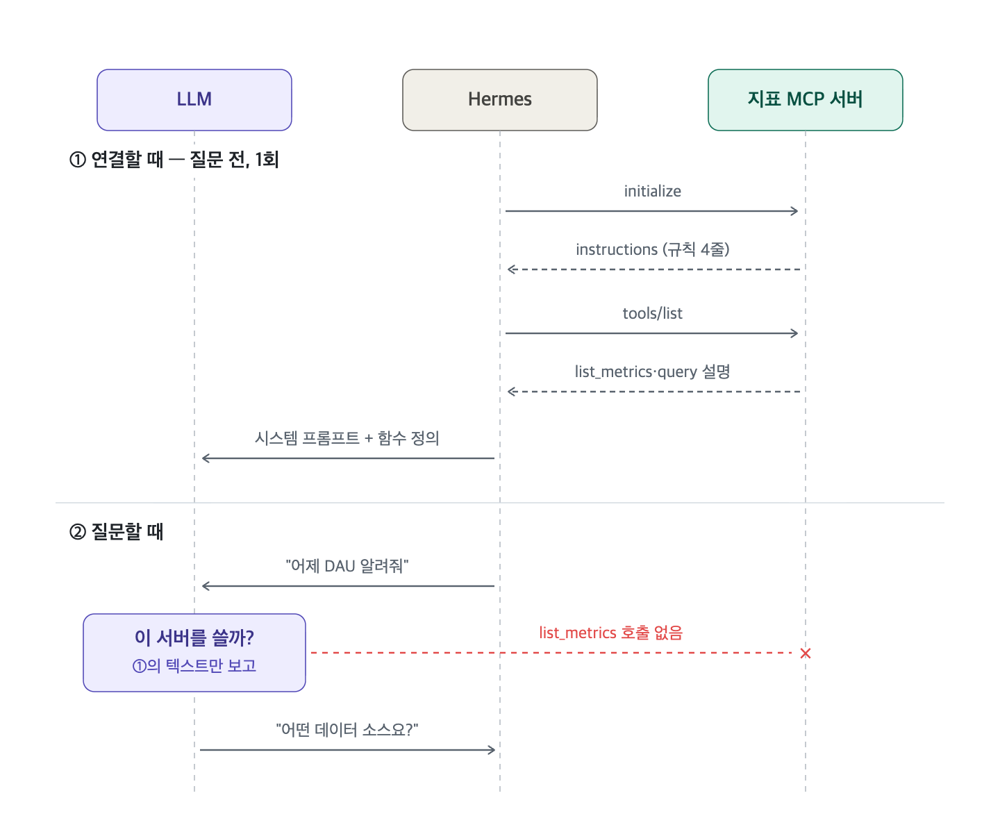
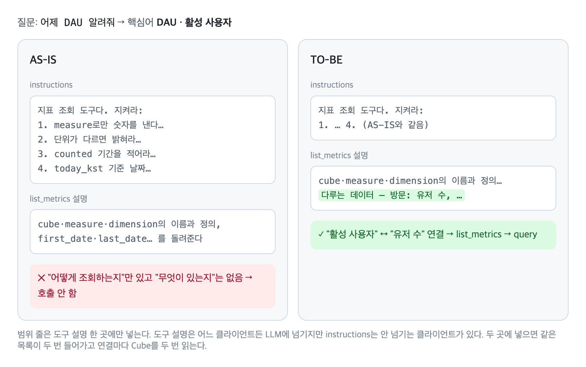
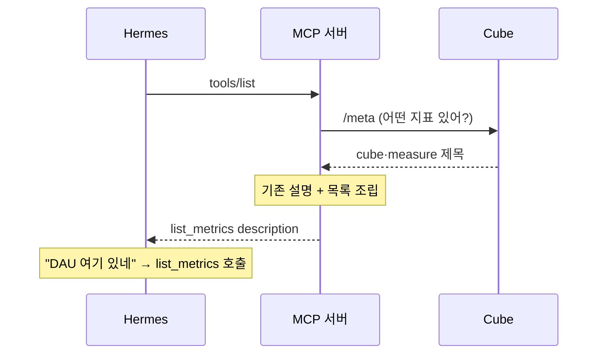

# Hermes Agent로 지표 조회 봇 붙이기 — 트러블슈팅

> 원격 리눅스 서버(브라우저 없음)에 Hermes를 설치하고 사내 MCP 서버를 연결하며 막힌 지점

## 전체 구조



## 레이어 구조 — 질문에서 원천 데이터까지



| 레이어 | 하는 일 | 한 줄 |
|---|---|---|
| 깨우는 쪽 | 일을 시작시킴 | 사람·타이머·앱 무엇이든 호스트를 깨울 뿐 |
| 호스트 | LLM이 판단, MCP 클라이언트가 포장·전송 | 도구를 부를지 말지는 LLM이 정함 |
| MCP 규격 | 서버와 대화하는 공통 문법 | 연결 때 `initialize`·`tools/list` 1번, 질문마다 `tools/call` |
| MCP 서버 | 도구와 그 설명을 내놓음 | 같은 Cube 위에 공개 범위만 다른 서버를 여러 개 둘 수 있음 |
| Cube | 지표 정의(시맨틱 레이어) | view로 묶어 노출, cube는 마트 테이블마다 하나 |
| dbt 데이터마트 | 원천을 지표 재료로 정리 | staging → intermediate → mart(fct·dim) |
| 원천 데이터 | 실제 기록 | RDB·GA4를 Airflow·ECS로 BigQuery raw에 적재 |

> 위로 갈수록 "무엇을 물을지", 아래로 갈수록 "무엇이 사실인지"를 다룬다. 지표 정의는 Cube 한 곳에만 둔다

## 한눈에 보기

| # | 증상 | 원인 | 해결 |
|---|---|---|---|
| 1 | Codex 로그인이 `Waiting for sign-in...`에서 멈춤 | 사람 승인 대기 중 (기기 코드 방식) | 아무 기기 브라우저에서 코드 입력 |
| 2 | MCP 서버가 인증 없이 등록됨 | Codex 설정 가져오기가 `url`만 옮김 | `auth: oauth` 직접 추가 |
| 3 | `/mcp` → `Unknown command` | 로그인은 채팅 명령이 아니라 CLI 명령 | `hermes mcp login <server>` |
| 4 | 로그인 후 브라우저 `연결할 수 없음` | 콜백이 원격 서버의 `127.0.0.1`로 감 | 주소창 URL을 원격 터미널에 붙여넣기 |
| 5 | 배너에 `Nous Research` 표시 | 만든 곳 표시일 뿐 | `hermes config`로 provider 확인 |
| 6 (핵심) | 지표를 물었는데 MCP 도구를 안 씀 | 서버 설명에 **데이터 범위**가 없음 | 서버 설명 보강, SOUL.md는 역할만 |

---

## 1. Codex 기기 코드 로그인



| 포인트 | |
|---|---|
| 팁 | 로그인하는 기기 ≠ 코드 받는 기기여도 됨 → **포트 포워딩 불필요** |
| 주의 | 코드는 10~15분 뒤 만료 → `Ctrl+C` 후 재시작 |

## 2. 가져온 MCP 설정에 인증 누락

```diff
 mcp_servers:
   semantic:
     url: https://<mcp-server>/mcp
+    auth: oauth
```

| 포인트 | |
|---|---|
| 팁 | 마법사가 "성공"이라 해도 **파일을 열어 확인** |
| 주의 | 들여쓰기는 공백, `url`과 같은 깊이 (탭 금지) |

## 3. MCP 로그인 명령

| 틀린 시도 | 정답 |
|---|---|
| 채팅에서 `/mcp` | `hermes mcp login <server>` |
| | `hermes mcp test <server>` (연결·도구 확인) |

> 교훈: 명령을 추측하지 말고 **공식 문서부터** 찾기

## 4. 브라우저 없는 서버에서 OAuth 콜백 받기



| 방법 | 장점 | 명령 |
|---|---|---|
| **붙여넣기** (추천) | 준비 없음 | 에러 페이지 주소창 URL → 원격 터미널 |
| SSH 포트 포워딩 | 리다이렉트가 자동으로 도착 | `ssh -N -L <포트>:127.0.0.1:<포트> <user>@<host>` |
| `--flow device` | 브라우저 리다이렉트 없음 | MCP 서버가 기기 코드를 지원해야 함 |

| 주의 | |
|---|---|
| `^[[B^[[A` | 화살표 키 잔여물 → 붙여넣기 전 `Ctrl+U` |
| `code` | 일회용이지만 계정 정보 포함 → **원격 터미널에만** 붙이기 |

## 5. provider 확인

```bash
hermes config | grep -iE 'provider|model'
# provider: openai-codex
```

> 교훈: **화면 문구 < 설정값**

## 6. (핵심) 봇이 MCP 도구를 안 씀

### 무슨 일이 있었나



### 원인 추적



### 비유

| 실제 | 비유 |
|---|---|
| MCP 서버 | 자료실 — 문에 "자료실" 팻말만 |
| Cube 지표 정의 | 자료실 안의 책 |
| 서버 지침 | 자료실 이용 수칙 |
| Hermes | 새 직원 — DAU가 거기 있는지 몰라 안 들어감 |

### 처음 대응 → 수정

| | 처음 (잘못) | 수정 |
|---|---|---|
| SOUL.md | 조회 절차·답변 규칙을 길게 | 역할만: "지표 조회 봇, 다른 도구 금지" |
| 문제 | 서버 지침과 **중복** → 이미 문구가 어긋남 | |
| 서버 설명 | 그대로 | **다루는 데이터 범위 추가** |

### 정보는 어디에



> 교훈: 에이전트가 도구를 안 쓰면 → **"도구 설명만 보고 이 질문용이라 알 수 있나?"** 부터 확인. 고칠 곳은 대개 도구를 **제공하는 쪽**

## 7. MCP 서버에 "팻말" 붙이는 법

### 팻말 자리는 MCP 규약에 이미 있다





### 누가 무엇을 하나

| | 역할 | 비유 |
|---|---|---|
| Cube | 어떤 지표가 있는지 앎 (cube·measure 제목) | 소장 목록 |
| MCP 서버 | Cube에 물어 소개 글에 옮겨 적음 | 팻말 쓰는 사람 |
| 팻말 | `list_metrics` 설명 | 문 앞 안내판 |



### 설계 포인트

| 포인트 | |
|---|---|
| 자동 생성 | 코드에 손으로 적으면 Cube 지표가 바뀔 때마다 낡음 → 매번 `/meta`에서 읽음 |
| 이름만 | 지표 **정의**(`description`)는 팻말에 안 넣음 → `list_metrics` 안에서 읽힘 (길이·중복 방지) |
| 한 곳만 | 도구 설명은 모든 클라이언트가 넘김, `instructions`는 안 넘기는 클라이언트도 있음 → 도구 설명에만. 두 곳이면 목록 중복 + Cube 2회 |
| 장애 시 | Cube가 죽으면 목록 없이 예전 소개 + 경고 로그 (서버는 계속 응답) |
| 비용 | `tools/list`마다 `/meta` 1회 추가, 타임아웃 없음 → Cube가 느리면 도구 목록도 느림 |

### 두 칸 중 어디에 — 처음엔 둘 다, 다시 보니 하나

| | `instructions` | 도구 `description` |
|---|---|---|
| 언제 받나 | `initialize` (연결 1회) | `tools/list` (연결 1회) |
| LLM에 닿나 | 클라이언트마다 다름 (안 넘기는 곳 있음) | 항상 — 함수 정의의 일부 |
| 봇이 쓰는 순간 | 서버 전체 인상 | **"이 도구를 부를까"** 고를 때 |
| 담을 것 | 답하는 방식 (규칙 4줄) | 다루는 데이터 (범위 목록) |

| | 처음 (두 곳) | 다시 (한 곳) |
|---|---|---|
| 컨텍스트 | 같은 목록 2번 | 1번 |
| 연결당 Cube `/meta` | 2회 | 1회 |
| `initialize`가 Cube에 묶임 | 예 | 아니오 (고정 응답) |
| 닿는 클라이언트 | 같음 | 같음 |

> 깨달음: "혹시 모르니 두 곳에"는 얇은 서버의 적이다. **반드시 닿는 칸 하나**를 고르면 중복도, 의존도, 호출도 같이 준다. 정보는 그걸 **쓰는 순간에 보이는 칸**에 둔다

> 교훈: MCP 서버의 "자기소개"는 규약에 정해진 두 칸(`instructions`, 도구 `description`)뿐. 봇이 알아야 할 건 **여기에** 적어야 닿는다

---

## 기타 메모

| 항목 | 내용 |
|---|---|
| 게이트웨이 자동 시작 `n` | systemd 파일은 생성됨, linger 켜짐, 실행은 안 됨 |
| CLI 도구 | file·terminal·skills 켜져 있음 → Slack용은 `hermes tools`에서 따로 끄기 |

## 다음 할 일

- [ ] SOUL.md 줄인 뒤 재시험 → 답에 measure 이름·기간(from~to) 나오는지
- [x] MCP 서버 설명에 데이터 범위 추가 (사내 repo PR 올림 — `list_metrics` 설명 한 곳으로 수정, 머지·재배포 대기)
- [x] Slack 앱 생성 → 토큰 등록 → Slack은 MCP만 남기기 ([다음 노트](16-mcp-deploy-and-slack-bot.md))
- [ ] 개인 계정 → 봇 전용 계정 전환 여부 결정
