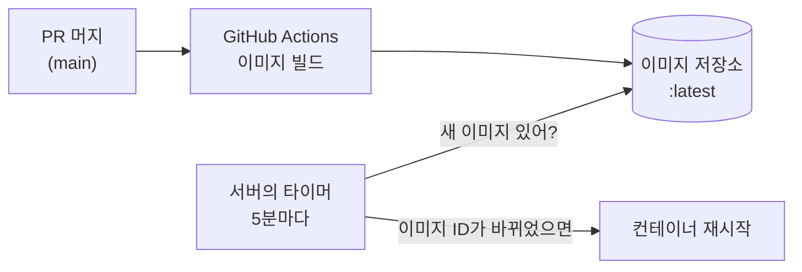
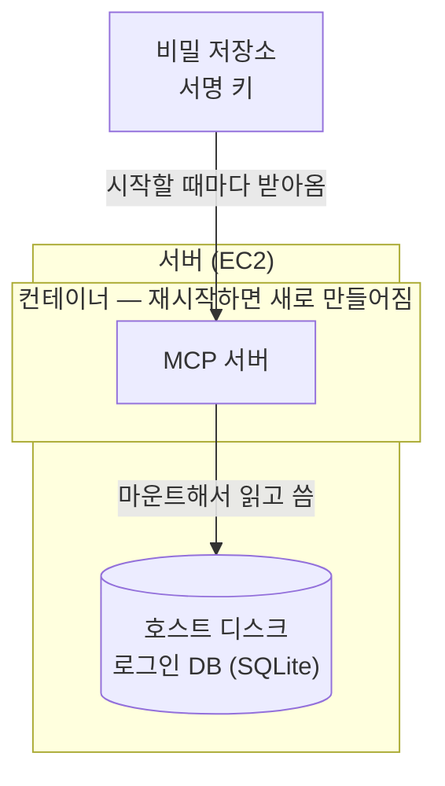
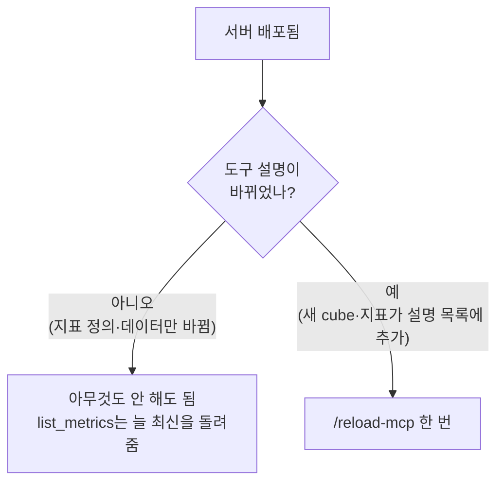
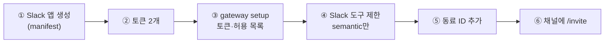

# MCP 서버 배포 흐름과 Slack 봇 공개까지

> 서버를 고친 뒤 "이게 어떻게 배포되고, 봇은 언제 새 설명을 보나"를 따라가고, 봇을 Slack 공개 채널에 열기까지
> 앞 노트: [Hermes Agent로 지표 조회 봇 붙이기 — 트러블슈팅](16-hermes-slack-bot-mcp-troubleshooting.md)

## 한눈에 보기

| # | 질문 | 답 |
|---|---|---|
| 1 | PR 머지하면 서버에 어떻게 반영되나? | **자동.** 이미지 빌드 → 서버가 5분마다 새 이미지 확인 → 바뀌었으면 스스로 재시작 |
| 2 | 서버 재시작하면 모두 로그아웃되나? | **아니오.** 로그인 정보가 컨테이너 밖 디스크(SQLite)에 있음 |
| 3 | 서버 재시작할 때마다 봇도 재시작? | **아니오.** 도구 **설명**이 바뀔 때만 `/reload-mcp` 한 번 |
| 4 | 봇을 동료와 공개 채널에서 쓰려면? | Slack 앱 → 토큰 2개 → **도구를 데이터 조회만 남기고** → 허용 목록 → 채널 초대 |

---

## 1. 머지에서 서버 재시작까지 — 사람 손 없음



| 포인트 | |
|---|---|
| 방식 | **당겨오기(pull)** — 서버가 스스로 확인. CI가 서버에 들어가 명령을 치는 **밀어넣기(push)** 가 아님 |
| 밀어넣기를 안 쓴 이유 | CI에 "서버에서 명령 실행" 권한을 주면 사실상 서버 root를 주는 것 |
| 대가 | 머지 후 반영까지 **최대 약 5분 + 빌드 시간** |
| 설정 위치 | 타이머·재시작 스크립트는 IaC(Terraform) repo — 서버를 만들 때 함께 깔림 |

> 교훈: "CI/CD가 없네, 추가하자" 전에 **IaC repo부터** 확인. 이미 있었고, 일부러 고른 방식이었다

## 2. 재시작해도 로그인이 유지되는 이유



| 상황 | 로그인 |
|---|---|
| 컨테이너 재시작 (배포) | ✅ 유지 — DB는 컨테이너 밖, 서명 키도 같음 |
| 서버(인스턴스) 교체 | ❌ 초기화 — 호스트 디스크째 새로 만들어짐 |

> 교훈: "재시작 = 상태 날아감"이 아니다. **상태를 어디에 두었는지**(컨테이너 안 / 호스트 디스크 / 외부 DB)가 정한다

## 3. 봇은 언제 새 도구 설명을 보나

### 봇이 도구 목록을 다시 받는 순간

| 시점 | 자동? |
|---|---|
| 봇 시작 | ✅ |
| `/reload-mcp` (Slack에선 `/hermes reload-mcp`) | 사람이 보냄 |
| 서버가 "목록 바뀜" 알림(`list_changed`) | ❌ 우리 서버는 상시 연결이 없어 못 보냄 |
| 봇 설정 파일 변경 | ✅ (약 1분 내 감지) |

### 그래서 언제 reload가 필요한가



| 헷갈렸던 점 | 정리 |
|---|---|
| 서버 재시작 = 봇 재시작? | 아님. 봇은 다음 호출 때 그냥 다시 연결 |
| reload 안 하면 고장? | 아님. 예전 설명을 볼 뿐 — 새 지표를 "있는 줄 모를" 수 있음 |
| `hermes mcp test`로 확인되나? | 아님. 그 명령은 **따로 새 연결**을 열어서, 돌고 있는 봇이 갱신됐다는 증거가 안 됨 |

### 다른 곳은 어떻게 하나

| 패턴 | 방식 | 우리에게 |
|---|---|---|
| ① 고정 설명 + 목록은 도구 뒤에 | 설명엔 "지표 조회용"만, 목록은 호출해야 보임 | 이게 바로 **원래 실패한 상태** (봇이 안 부름) |
| ② 대화마다 재연결 | 매번 새로 `tools/list` | 클라이언트가 정함 — 우리가 못 바꿈 |
| ③ `list_changed` 알림 | 서버가 바뀌었다고 알려 줌 | 상시 연결(SSE)이 필요 — 지금 서버 구조와 안 맞음 |

> 결정: 지금 방식(설명에 범위 목록) 유지. **새 cube가 생길 때만** reload. 쓰면서 관찰한 뒤 다시 본다

## 4. Slack 봇 공개까지



### ① manifest — 필요한 것만

| 항목 | 기본값 | 바꾼 것 | 이유 |
|---|---|---|---|
| 슬래시 명령 | 약 50개 (`/new`, `/help`, `/yolo`…) | **`/hermes` 하나** | 워크스페이스 **전체** 자동완성을 덮음, 이름 충돌, 위험한 스위치 노출 |
| 앱·봇 이름 | Hermes | 팀이 알아보는 이름 | `display_name`이 `@멘션` 이름 — 두 곳 다 바꿔야 함 |
| `socket_mode_enabled` | `true` | 그대로 | 공개 URL 없이 봇이 Slack에 직접 접속 |

> manifest = **설계도**. 브라우저의 앱 생성 화면에 한 번 붙여넣는 것이지 채팅창에 치는 게 아님

### ② 토큰 두 개

| 토큰 | 모양 | 받는 곳 | 하는 일 |
|---|---|---|---|
| App 토큰 | `xapp-` | Basic Information → App-Level Tokens (`connections:write`) | Socket Mode 연결 |
| Bot 토큰 | `xoxb-` | Install App → Install to Workspace | 메시지 읽기·쓰기 |

> 토큰은 **터미널 입력에만**. 채팅·커밋·노트에 절대 안 붙임

### ③ gateway setup에서 묻는 것

| 질문 | 답 |
|---|---|
| Allowed user IDs | Slack Member ID(`U…`)를 **쉼표로** — 비우면 아무도 못 씀 |
| Home channel | 예약 작업 결과 받을 곳. 처음엔 비워 두고, 안내 문구가 거슬리면 봇 DM에서 `/hermes sethome` |
| Restart gateway? | `y` — 이미 서비스로 돌고 있으면 `hermes gateway`는 "nothing to start"가 정상 |

### ④ (중요) 플랫폼별 도구 제한

Hermes는 데이터 봇이 아니라 **범용 에이전트**. 기본으로 Slack에도 파일·터미널이 켜져 있었다.

| 도구 | CLI (나) | Slack (동료) | 이유 |
|---|---|---|---|
| semantic (MCP) | ✅ | ✅ | 본업 |
| 📁 File Operations | ✅ | ❌ | 토큰 든 설정 파일을 읽을 수 있음 |
| 💻 Terminal | ✅ | ❌ | 봇이 도는 컴퓨터에서 아무 명령이나 |
| 📚 Skills · 👁️ Vision | ✅ | ❌ | 데이터 조회에 불필요 |

```bash
hermes tools --summary                                       # 플랫폼별 현황
hermes tools disable --platform slack file terminal skills vision
hermes -p default gateway restart
```

검증: 봇에게 "ls 실행해줘" → **못 한다고 해야 성공**, "어제 DAU" → 여전히 답해야 함

> 교훈: 사람을 늘리기 **전에** 봇의 손을 줄인다. 허용 목록은 "누가 말할 수 있나", 도구 제한은 "말하면 무엇까지 하나" — 둘은 다른 문이다

### ⑤⑥ 채널에서 쓰기

| 어디서 | 방법 |
|---|---|
| 봇과 1:1 DM | 사이드바 **앱** → 봇 → 메시지 |
| 공개·비공개 채널 | `/invite @<bot>` 후 `@<bot> 어제 DAU 알려줘` → 스레드로 답 |
| ❌ 사람끼리 하던 DM | 중간에 봇을 끼울 수 없음 ("비공개 채널로 옮길래요?"가 뜨면 취소) |

### 남은 위험

| 위험 | 지금 상태 |
|---|---|
| 누가 물어도 조회 기록은 **봇 주인 한 명의 Google 계정**으로 남음 | 몇 명일 땐 감수. 사람별 기록이 필요하면 따로 설계 |
| 봇이 도는 컴퓨터가 꺼지면 봇도 멈춤 | 유저 서비스(systemd, linger 켜짐)로 돎 — 재부팅 후 자동 시작되는지는 아직 확인 안 함 |

---

## 기타 메모

### dbt ≈ "쿼리판 Terraform"? — 반은 맞음

| | Terraform | dbt |
|---|---|---|
| 정의하는 것 | 인프라 (서버·버킷) | 테이블 = `SELECT` 문 |
| 순서 | 리소스 참조 | `ref()` 참조 |
| 상태 파일 | 있음 (무엇을 만들었나 기억) | **없음** — 매 실행 다시 만듦 (incremental만 예외) |
| 검증 | plan | 테스트 내장 (`unique`, `not_null`…) |

### 바꿀까 말까 — "모양으로 찾기" vs "표식 달기"

서버는 특정 컬럼 4개를 가진 cube를 "데이터 날짜 범위 cube"로 알아본다. 표식(`meta.role`)을 달자는 생각이 들었지만:

- 표식을 달아도 서버는 **그 컬럼들을 여전히 읽어야** 함 → 컬럼 이름 의존은 그대로
- 지금도 못 찾으면 모든 조회가 설정 오류로 **시끄럽게** 실패 → 조용히 틀릴 위험 없음

> 결정: 지금은 안 바꿈. "깔끔해 보이는가"가 아니라 **"무엇이 실제로 나아지는가"** 로 판단

## 다음 할 일

- [ ] 서버 PR 머지 → 빌드 + 약 5분 → `/hermes reload-mcp` → "어제 DAU" 재시험
- [ ] 동료가 채널에서 직접 물어보고 답 확인
- [ ] 쓰면서 관찰: 봇이 도구를 안 부르는 질문이 있는지
- [ ] 개인 계정 → 봇 전용 계정 전환 여부 결정
