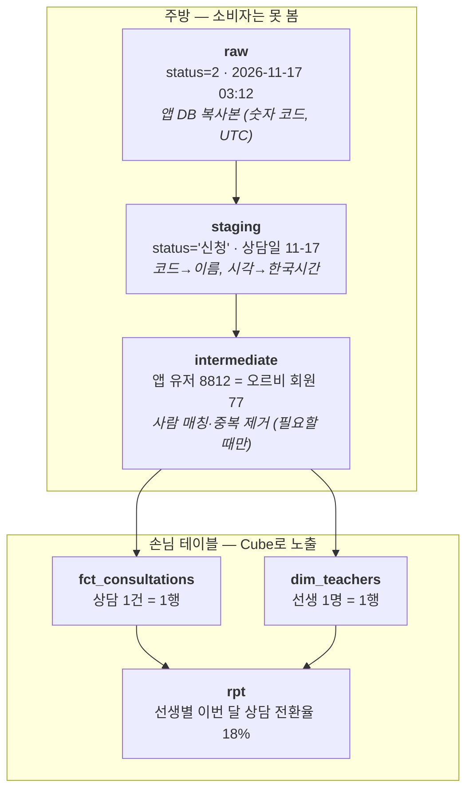
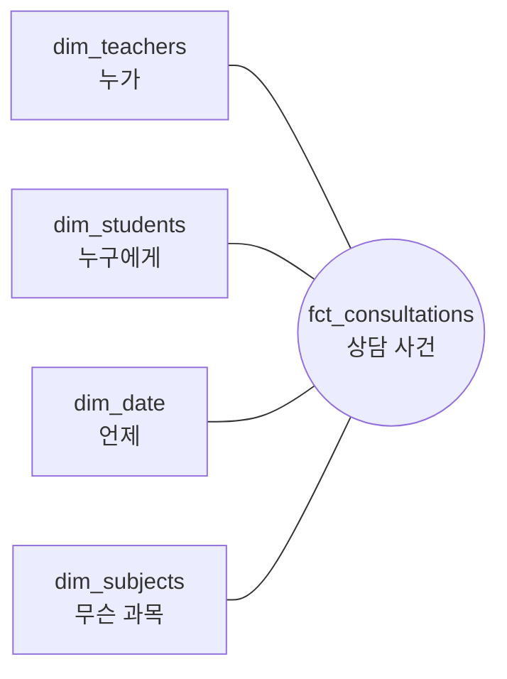

# 데이터 마트 층 구조 — raw · staging · intermediate · mart(fct · dim · rpt)

> dbt 프로젝트에 왜 층이 나뉘어 있는지, fct와 dim이 무엇인지를 가계부 비유로 정리했다
> 앞 노트: [데이터 엔지니어링 전체 구조 정리](13-data-engineering-overview.md)

## 한눈에 보기

| 층 | 가계부로 치면 | 하는 일 | 한 줄 = |
|---|---|---|---|
| **raw** | 지갑 속 구겨진 영수증 뭉치 | 원본을 그대로 복사해 둔다 | 원본 한 줄 |
| **staging** | 영수증을 펴서 같은 양식에 옮겨 적기 | 겉모양만 정리한다 (코드→이름, UTC→KST) | 원본 한 줄 |
| **intermediate** | 같은 결제가 두 번 찍힌 영수증 골라내기 | 사람 잇기·중복 제거. **필요할 때만** 만든다 | 경우에 따라 다름 |
| **mart · fct** | 가계부의 지출 내역 페이지 | 사건을 기록한다 | 사건 1건 |
| **mart · dim** | 가계부의 가게 목록 페이지 | 대상의 속성을 적는다 | 대상 1개 |
| **rpt** | "이번 달 식비 얼마?"의 답 | fct + dim으로 질문 하나에 답한다 | 질문마다 다름 |

> 외울 것 두 개
> 1. **점선 위는 주방, 아래는 손님 테이블.** 소비자(Metabase·에이전트)는 mart와 rpt만 본다
> 2. **fct는 동사(했다), dim은 명사(누구).** fct에는 "선생 55번이 상담했다"까지만 적고, 55번이 누구인지는 dim에서 찾는다

---

## 1. 한 건의 데이터가 층을 지나는 모습

과외 앱의 **상담 신청 한 건**을 따라가 보면 이렇다.



| 층 | 바뀐 것 |
|---|---|
| raw → staging | 값의 **모양**만 바뀐다. 줄 수는 그대로 |
| staging → intermediate | 서로 다른 출처의 **같은 것을 잇는다** |
| intermediate → mart | **소비자가 물을 단위**(사건 / 대상)로 다시 짠다 |
| mart → rpt | 질문 하나를 위해 **계산**한다 |

---

## 2. fct와 dim — 가계부 안의 두 페이지

```
[ 지출 내역 ] = fct                 [ 가게 목록 ] = dim
날짜   가게번호  금액               가게번호  가게이름   종류
11/1   3        5,000              3        김밥천국   식당
11/2   7        12,000             7        GS25      편의점
11/2   3        4,500
```

| | fct (사건표) | dim (명부) |
|---|---|---|
| 한 줄 = | 일어난 일 1건 | 대상 1개 |
| 품사 | 동사 — 했다, 샀다, 봤다 | 명사 — 누구, 어디, 무엇 |
| 늘어나는 방식 | 일이 생길 때마다 계속 쌓인다 | 거의 그대로, 가끔 수정 |
| 주로 들어가는 것 | 날짜, 숫자(금액·횟수), 대상 번호 | 이름, 종류, 가입일 같은 속성 |
| 과외 앱 예 | `fct_consultations` 상담 1건 | `dim_teachers` 선생 1명 |
| 오르비 예 | `fct_contributions` 글·댓글 1건 | `dim_members` 회원 1명 |

**왜 나누나?** 가게 이름을 지출 내역 줄마다 적으면, 가게 이름이 바뀔 때 모든 줄을 고쳐야 한다. 번호만 적어 두면 목록 한 곳만 고치면 된다.

---

## 3. 이 구조를 부르는 이름



가운데 fct가 있고 dim이 둘러싼 모양이 **별** 같다 → **스타 스키마**

| 무엇을 가리키나 | 이름 | 검색 키워드 |
|---|---|---|
| fct와 dim으로 나누는 설계법 | 차원 모델링 (Kimball) | `차원 모델링`, `dimensional modeling` |
| fct 중심에 dim이 붙은 모양 | 스타 스키마 | `star schema` |
| raw → staging → mart로 층을 쌓기 | 데이터 레이어링 | `dbt 레이어`, `dbt project structure` |
| 같은 층 구조의 다른 이름 | 메달리온 아키텍처 | `medallion` — bronze=raw, silver=staging, gold=mart |
| 이 과정을 자동으로 돌리는 흐름 | ELT 파이프라인 | `ELT` — 가져오고(E) 넣고(L) 바꾼다(T) |

---

## 4. 헷갈렸던 것

| 질문 | 답 |
|---|---|
| intermediate는 항상 있어야 하나? | **아니다.** 잇기·중복 제거가 없으면 staging에서 mart로 바로 간다. 빈 층을 미리 만들지 않는다 |
| staging에서 계산도 해도 되나? | **안 된다.** 원본 1개 = staging 1개, 모양 정리만. "누가 회원인가" 같은 판정은 mart에서 |
| rpt는 fct랑 뭐가 다른가? | fct는 **사실 원본**(1건 = 1행), rpt는 그걸 **가공한 답**(집계·코호트). rpt에 `fct_`를 붙이면 어느 표가 원본인지 이름에서 사라진다 |
| 소비자가 staging을 직접 보면 안 되나? | 안 된다. 판정 로직이 화면마다 따로 생겨서 같은 지표가 다르게 나온다. 소비자의 유일한 계약면은 mart |
