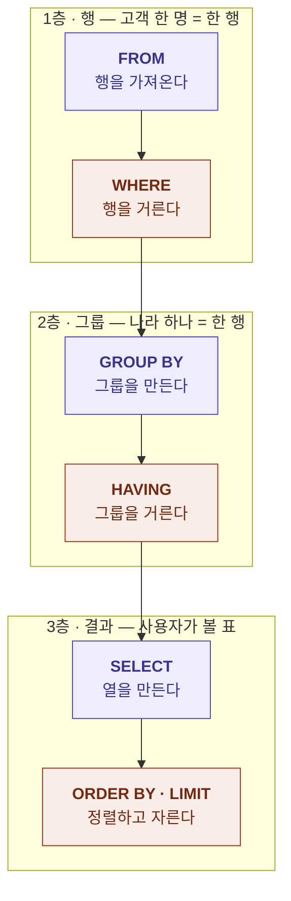
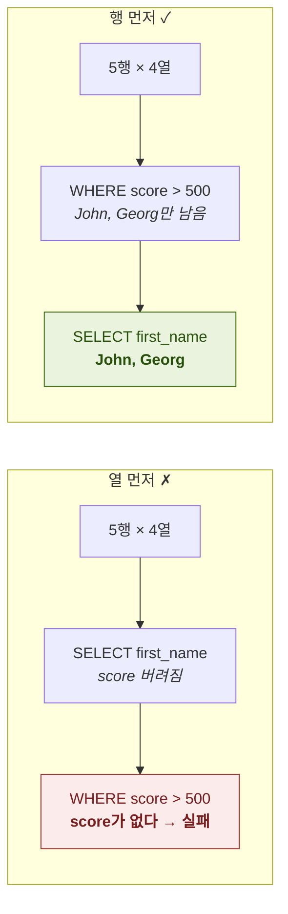

# SQL 실행 순서 — 쓰는 순서와 도는 순서는 다르다

> `SELECT * FROM customers`를 보다가 생긴 질문에서 시작했다. "자연어라면 테이블부터 고르는 게 맞지 않나?"
> 예제 테이블: `customers(id, first_name, country, score)` 5행

## 한눈에 보기

| 쓰는 순서 | 절 | 실행 순서 | 하는 일 |
|:---:|---|:---:|---|
| 1 | `SELECT` | **5** | 보여줄 열을 만든다 |
| 2 | `FROM` | **1** | 행을 가져온다 |
| 3 | `WHERE` | **2** | 행을 거른다 |
| 4 | `GROUP BY` | **3** | 행을 묶어 그룹을 만든다 |
| 5 | `HAVING` | **4** | 그룹을 거른다 |
| 6 | `ORDER BY` · `LIMIT` | **6** | 정렬하고 자른다 |

> 외울 것 세 개
> 1. **쓰는 순서는 영어 문장, 도는 순서는 FROM부터.**
> 2. **3층 × (만들고 → 거른다).** 행 → 그룹 → 결과
> 3. **논리 순서는 결과에 대한 약속이다.** 실제 엔진은 결과만 같으면 순서를 바꾼다

---

## 1. 왜 문법은 SELECT가 먼저인가

SQL의 전신 SEQUEL(1974, IBM)은 **비개발자도 영어 문장처럼 읽게** 만드는 게 목표였다.

```
Give me  the names   from customers   where score > 500
SELECT   first_name  FROM customers   WHERE score > 500
```

원하는 것을 먼저 말하는 선언형 문장이라 SELECT가 앞에 온다. 대신 IDE가 컬럼 자동완성을 못 하는 등 불편해서, 최근 문법들은 FROM을 앞으로 보낸다.

| 문법 | 예 |
|---|---|
| BigQuery 파이프 문법 | `FROM customers \|> WHERE score > 500 \|> SELECT first_name` |
| DuckDB | `FROM customers SELECT first_name;` |
| C# LINQ, KQL, PRQL | 모두 `from`으로 시작 |

---

## 2. 실행 순서 = 3층 × (만들고 → 거른다)



보라 = 만든다 · 주황 = 거른다

**왜 이 순서밖에 없나 → "없는 건 거를 수 없다"**

- 그룹이 있어야 그룹을 거른다 → `HAVING`은 `GROUP BY` 뒤
- Peter를 빼고 합쳐야 합계가 맞다 → `WHERE`는 `GROUP BY` 앞
- 결과가 정해져야 정렬한다 → `ORDER BY`는 `SELECT` 뒤

---

## 3. 쿼리 하나 따라가기

```sql
SELECT country, SUM(score) AS total   -- 5
FROM customers                        -- 1
WHERE score > 0                       -- 2
GROUP BY country                      -- 3
HAVING SUM(score) > 800               -- 4
ORDER BY total DESC;                  -- 6
```

```
1. FROM             2. WHERE score > 0     3. GROUP BY country          4. HAVING SUM > 800
Maria   DE  350     Maria   DE  350        DE  [Maria, Martin]  850     DE  850
John    US  900     John    US  900        US  [John]           900     US  900
Georg   UK  750     Georg   UK  750        UK  [Georg]          750     UK  750  (x)
Martin  DE  500     Martin  DE  500
Peter   US    0     Peter   US    0  (x)

5. SELECT           6. ORDER BY total DESC
country  total      country  total
DE       850        US       900
US       900        DE       850
```

③에서 **표의 모양이 바뀐다.** 한 행이 고객이 아니라 나라가 된다. 그래서 그 뒤로 `first_name`은 못 쓴다 (DE 안에 이름이 두 개라 하나를 고를 수 없다).

---

## 4. 규칙: 아래층은 위층에서 만든 것만 쓴다

| 에러 상황 | 이유 | |
|---|---|:---:|
| `WHERE SUM(score) > 800` | 1층에서 2층 것(집계)을 쓰려 함 | ✗ |
| `WHERE total > 800` | 3층에서 만든 별칭을 1층에서 씀 | ✗ |
| `GROUP BY country` 후 `SELECT first_name` | 2층으로 오며 개별 행이 사라짐 | ✗ |
| `ORDER BY total` | 같은 3층이라 별칭이 이미 있음 | ✓ |

> 막히면 "지금 쓰려는 게 **몇 층에서 만들어지지?**"를 묻는다

---

## 5. 왜 행이 열보다 먼저인가

**보여줄 열 ≠ 계산에 필요한 열**이기 때문이다.

```sql
SELECT first_name FROM customers WHERE score > 500;
```



- 결과에 없는 `score`가 거를 때는 필요하다 → 열을 먼저 버리면 거를 근거가 사라진다
- `SUM(score) AS total` 같은 열은 **어떤 행이 남고 어떻게 묶였는지**가 정해져야 계산된다 → 열은 행 작업의 결과물

---

## 6. 논리 순서 vs 실제 실행

논리 순서는 **"결과가 이 순서로 계산한 것과 같아야 한다"는 약속**이지 작업 지시가 아니다.
`2×3 + 4×5`를 `4×5`부터 계산해도 답이 26인 것과 같다. SQL은 무엇을 원하는지만 적고, 어떻게 가져올지는 옵티마이저가 정한다.

```
          논리 순서 (머릿속 모델)        실제 실행 (옵티마이저)

           id  name  country  score      id  name  country  score
  Maria    #    #      #       #         .    x      .       x
  John     #    #      #       #         .    #      .       #
  Georg    #    #      #       #         .    #      .       #
  Martin   #    #      #       #         .    x      .       x
  Peter    #    #      #       #         .    x      .       x

           FROM → WHERE → SELECT         읽으면서 거르기 → SELECT
           읽은 칸 20                     읽은 칸 10

  # 읽음   x 읽고 바로 버림   . 아예 안 읽음     →  둘 다 결과는 John, Georg
```

| 재배치 | 하는 일 | 왜 안전한가 |
|---|---|---|
| Projection pushdown | 쿼리 어디에도 안 쓰이는 열은 안 읽음 | 안 쓰는 열은 결과에 영향 없음 |
| Predicate pushdown | 읽는 순간 조건 안 맞는 행을 버림 (JOIN 전에 거르기) | 버릴 행은 어차피 버려짐 |
| 인덱스 | 전체를 훑지 않고 조건 구간으로 점프 | 같은 행을 찾음 |
| Top-N | `ORDER BY … LIMIT 3`이면 전체 정렬 대신 상위 3개만 유지 | 상위 3개는 같음 |

**못 바꾸는 경우:** 결과가 달라질 때. `HAVING SUM(score) > 800`은 합계가 나와야 판단하므로 앞으로 못 온다. 반대로 `HAVING country = 'US'`는 WHERE로 내려도 같아서 옵티마이저가 옮기기도 한다.

> **BigQuery에서 `SELECT *`를 피하는 이유**가 이것. 컬럼형 DB는 읽은 열만큼 과금된다. 엔진이 남기는 열은 "SELECT에 적은 열"이 아니라 "쿼리 어디서든 쓰는 열"이다.

---

## 7. 직접 확인하기

| 도구 | 방법 |
|---|---|
| SSMS (SQL Server) | `Ctrl + M` (Include Actual Execution Plan) 켜고 실행 → Execution plan 탭 |
| BigQuery | 쿼리 결과 아래 **실행 세부정보** 탭 → 단계별 읽은 행 수 |
| PostgreSQL · MySQL | 쿼리 앞에 `EXPLAIN` |

> 쿼리를 **쓰고 이해할 때는 논리 순서**, **성능을 볼 때는 실행 계획**을 본다

---

## 8. 헷갈렸던 것

| 질문 | 답 |
|---|---|
| 왜 문법은 SELECT가 먼저? | 영어 문장처럼 "원하는 것 먼저" 말하려고. 실행 순서와는 무관 |
| WHERE와 HAVING 차이? | 둘 다 거른다. 대상이 **행**이냐 **그룹**이냐만 다르다 |
| 별칭은 어디서부터 쓸 수 있나? | SELECT(5) 이후. 그래서 ORDER BY에서만 된다 |
| 윈도우 함수(`ROW_NUMBER()`)를 WHERE에서 못 쓰는 이유? | SELECT 단계에서 계산되니까. 서브쿼리나 CTE로 한 번 감싼다 |
| 논리 순서가 있는데 엔진은 왜 다르게 도나? | 논리 순서는 결과의 정의일 뿐. 결과만 같으면 일하는 순서는 엔진 마음 |
