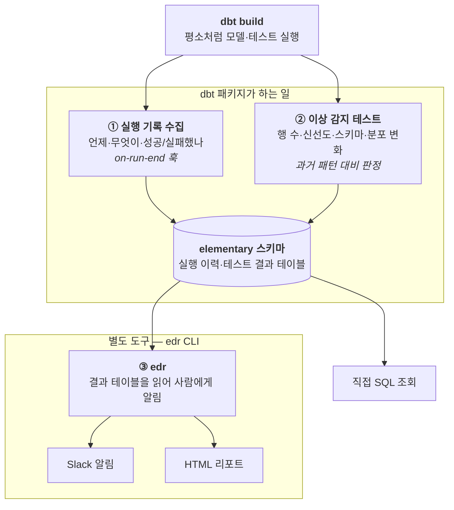
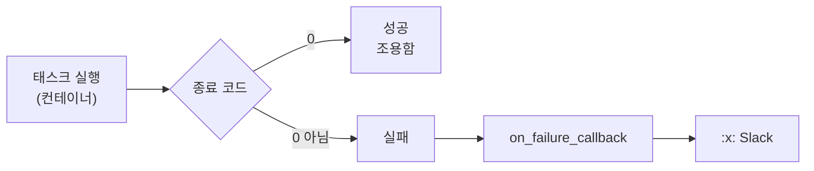
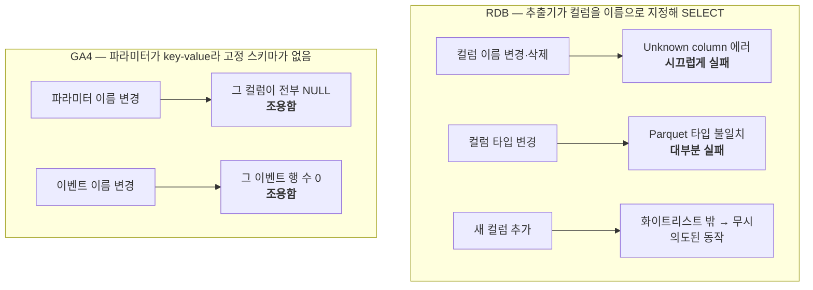
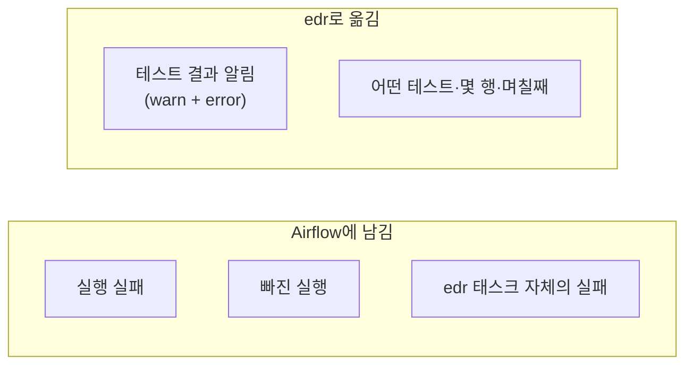

# 데이터 오류 감시는 두 층 — Airflow는 "돌았나", Elementary는 "맞나"

> 오픈소스 dbt 패키지 Elementary(`elementary-data/dbt-data-reliability`)가 무엇인지 보다가, 지금 파이프라인의 에러 처리가 어떻게 돌아가는지까지 정리했다
> 앞 노트: [데이터 마트 층 구조](17-data-mart-layers.md)

## 한눈에 보기

| | Airflow | Elementary (edr) |
|---|---|---|
| 묻는 질문 | 파이프라인이 **돌았나?** | 데이터가 **맞나?** |
| 판단 근거 | 프로세스 **종료 코드** (0이면 성공) | BigQuery에 쌓인 **실행·테스트 결과 테이블** |
| 잘 잡는 것 | 추출 실패, dbt 크래시, 실행 빠짐 | 행 수 급감, NULL 급증, 반복되는 경고 |
| 못 잡는 것 | 성공했는데 데이터가 틀린 경우 | 기록이 안 남은 실패 (추출 실패·크래시) |
| 비유 | 서버 헬스체크 — 살아 있나 | 에러 트래킹 — 응답 내용이 맞나 |

> 외울 것 두 개
> 1. **둘은 같은 걸 두 번 보는 게 아니다.** 보는 장애 종류가 다르다. 하나만 두면 다른 쪽 장애가 조용히 지나간다
> 2. **한 사건은 한 곳에서만 알린다.** 알림이 겹치면 사람은 결국 둘 다 안 읽는다

---

## 1. Elementary는 무엇인가

dbt에 붙이는 **데이터 품질 감시 카메라**. `packages.yml`에 추가하면 `dbt build`마다 끼어든다.



| 번호 | 역할 | 일반 dbt 테스트와 차이 |
|---|---|---|
| ① | 실행·테스트 결과를 **테이블로 누적** | dbt는 결과를 `run_results.json`에 쓰고 다음 실행에 덮어쓴다 → 이력이 없다 |
| ② | **평소와 다르면** 실패 | 일반 테스트는 "null이면 안 된다"처럼 규칙을 사람이 정한다. Elementary는 과거 분포(기본 14일)를 학습해서 판정 |
| ③ | 결과를 Slack·리포트로 | 패키지가 아니라 따로 설치·실행하는 CLI |

- 라이선스 Apache-2.0. 상용 버전 Elementary Cloud는 lineage·카탈로그 등을 더한다
- 같은 분야 도구: Monte Carlo(상용), Soda, Great Expectations

---

## 2. Airflow는 에러를 어떻게 아나 — 종료 코드

Airflow는 **데이터를 보지 않는다.** 태스크 = 컨테이너 하나를 띄우는 것이고, 그 프로세스가 0이 아닌 코드로 끝나면 실패로 친다.



그래서 에러 처리의 핵심은 **"무엇이 0 아닌 코드를 내게 만드나"** 다.

| 상황 | 판단하는 쪽 | Airflow가 아는 방법 |
|---|---|---|
| 추출(ECS) 실패 | 추출기 컨테이너 | 종료 코드 ≠ 0. 뒤의 dbt는 안 돈다 |
| 모델 SQL 오류 | dbt | 종료 코드 ≠ 0 |
| `severity: error` 테스트 실패 | dbt | 종료 코드 ≠ 0 → 하류 모델 SKIP |
| 셀렉터가 모델을 0개 고름 (태그 오타) | dbt | 원래는 성공. 경고를 에러로 올리는 옵션으로 ≠ 0 |
| `severity: warn` 테스트 실패 | dbt | **종료 코드 0 → Airflow는 성공으로 봄.** 그래서 실행 후 `run_results.json`을 따로 열어 warn을 찾아 Slack에 보낸다 |
| 실행 자체가 안 돎 | Airflow | 매일 아침 별도 DAG가 "오늘 예약된 실행이 있었나"를 조회 |

> **error vs warn**: error는 "하류를 멈춰라"(게이트), warn은 "알기만 해라"(알람). warn은 일부러 dbt를 성공시키므로 종료 코드로는 안 보인다

---

## 3. 누가 무엇을 잡나

| 장애 | Airflow | edr |
|---|:---:|:---:|
| **실행이 안 됨 → 결과 테이블이 비어 있음** | | |
| 추출 실패 (BigQuery엔 어제 데이터 그대로) | 잡음 | 모름 |
| dbt 컴파일 오류·크래시 | 잡음 | 모름 |
| 예약 실행이 아예 안 돎 | 잡음 | 모름 |
| **실행은 성공 → 데이터가 틀림** | | |
| 테스트 안 쓴 테이블의 행 수 반토막 | 모름 | 잡음 |
| NULL 비율 급증 | 모름 | 잡음 |
| 같은 경고가 2주째 반복 | 모름 | 잡음 |

겹치는 칸이 없다 → 두 층이 **서로의 사각지대**를 덮는다.

**둘 다 못 잡는 것**: Airflow가 통째로 죽으면 "실행 빠짐 감시"도 Airflow 안에서 돌기 때문에 같이 멈춘다. Airflow **바깥**의 감시가 필요하다.

---

## 4. "조용한 실패"가 뭔지

```
행 수        11/12  11/13  11/14  11/15  11/16  11/17  11/18
             ████   ████   ████   ████   ████   ████   ██
             10만   9.6만  10.4만 9.9만  10.2만 9.7만  5.1만  ← 반토막
Airflow      성공   성공   성공   성공   성공   성공   성공   ← 조용함
edr          정상   정상   정상   정상   정상   정상   이상   ← 평소 범위 밖
```

| 예 | 원인 | Airflow | edr |
|---|---|---|---|
| 이벤트가 반만 옴 | 앱 업데이트로 한 화면 태그 누락 | 적재 성공 | 평소 10만인데 5만 |
| 값이 이상해짐 | 로그인 버그로 user_id가 비어서 들어옴 | 행 수 정상, 성공 | NULL 비율 2% → 40% |

---

## 5. 스키마가 바뀌면 Airflow에서 잡히지 않나?

**소스에 따라 다르다.**



- RDB는 이미 **"조용한 성공 대신 시끄러운 실패"** 로 설계돼 있다
- 조용한 구멍은 GA4 쪽 → 필수 파라미터 NULL 테스트·택소노미 계약 테스트가 일부 막고 있다
- 그래서 이 파이프라인에서 Elementary의 **스키마 감지가 더해 주는 가치는 작다.** 진짜 가치는 "테스트 없는 테이블 감시"와 "이력"

---

## 6. 도입하면 달라지는 것

| 영역 | 지금 | 도입 후 | 변화 |
|---|---|---|---|
| 실행·테스트 이력 | 없음 (Slack 한 번 보내고 끝) | 매 실행 BigQuery에 누적 | **새로 생김** |
| 테스트 없는 테이블 | 못 잡음 | YAML 몇 줄로 행 수·신선도 감시 | **새로 생김** |
| 급변 판정 | 고정 임계치 (±50%, ±10%) | 과거 분포 기준 (요일 패턴 반영) | 선택지 추가 |
| 현황 화면 | Airflow UI와 Slack뿐 | HTML 리포트 | **새로 생김** |
| Slack 알림 | Airflow가 보냄 | edr도 보낼 수 있음 | **겹침** → 하나로 정해야 |
| 하류 차단 | dbt `severity: error` | 동일 (Elementary 테스트도 dbt 테스트) | 그대로 |
| Airflow 전체 다운 | 알림 없음 | 여전히 없음 | 그대로 |

**대가**: BigQuery 쓰기·스캔 비용 증가, 이력 14일이 쌓여야 판정이 안정됨, 파티션 필터 필수 테이블과의 호환 확인, edr 실행 태스크 추가

---

## 7. 알림을 어디서 할까 — 역할 분담



- 둘 중 하나를 고르는 문제가 아니라 **질문별로 나누는** 문제
- 덤으로 찾은 빈틈: 지금 Slack 알림은 warn 테스트만 상세를 보여 준다. **error 게이트가 실패하면 ":x: 실패 + 로그 링크"뿐**이라 어떤 테스트인지 로그를 열어야 안다 (dbt에서 실패한 테스트의 status는 `warn`이 아니라 `fail`이기 때문)

---

## 8. 헷갈렸던 것

| 질문 | 답 |
|---|---|
| 지금 Elementary가 있나? | **없다.** 비슷한 테스트를 손으로 쓰고(②의 일부), Airflow가 Slack으로 알린다(③의 일부). ①이력은 없다 |
| 에러 처리는 Airflow에서만 하나? | **아니다.** 에러를 **판단**하는 건 dbt 테스트와 추출기. Airflow는 종료 코드를 보고 **전달**만 한다 |
| 두 군데서 체크하면 중복 아닌가? | 아니다. 보는 장애가 다르다 (3번 표). 다른 회사도 오케스트레이터 알림 + 데이터 품질 도구의 2층 구조가 일반적 |
| 스키마 바뀌면 Airflow가 잡지 않나? | RDB는 대부분 잡는다(컬럼을 이름으로 SELECT하니까). GA4는 조용히 NULL이 된다 |
| edr로 알림을 다 옮기면? | 추출 실패·크래시는 BigQuery에 기록이 안 남아서 edr이 모른다. 실행 실패는 Airflow에 남겨야 한다 |

## 검색 키워드

| 무엇 | 키워드 |
|---|---|
| 이 분야 이름 | `data observability`, `데이터 옵저버빌리티` |
| Elementary 이상 감지 | `elementary volume_anomalies`, `elementary schema_changes` |
| dbt 테스트 심각도 | `dbt test severity warn error` |
| Airflow 실패 알림 | `airflow on_failure_callback slack` |
| 조용한 실패를 시끄럽게 | `fail loudly`, `silent data failure` |
