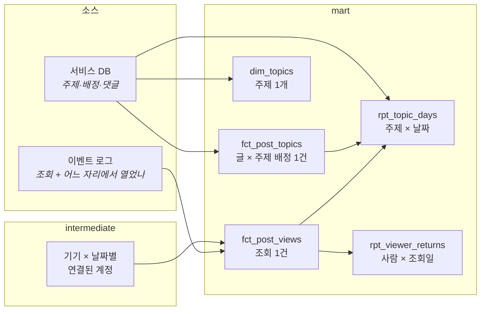
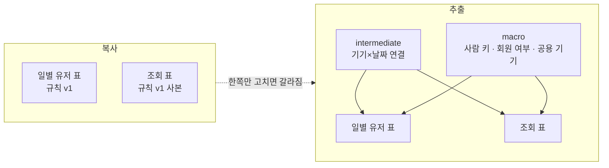
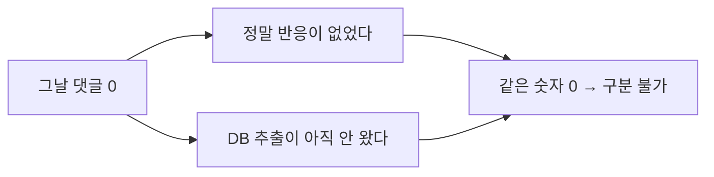

# 데이터가 있어도 숫자가 안 나오는 이유 — 지표 정의의 함정 5개

> "특집 영역이 효과가 있었나?"라는 질문 하나에 답하는 표를 설계하면서 정리했다. 문제는 데이터가 아니라 **정의**였다
> 앞 노트: [데이터 마트 층 구조](17-data-mart-layers.md) · [데이터 오류 감시는 두 층](18-data-quality-monitoring.md)

## 한눈에 보기

| 함정 | 증상 | 처방 |
|---|---|---|
| ① "사람"을 표마다 따로 정한다 | 같은 "회원 수"가 두 표에서 다르다 | 판정 규칙을 **intermediate 표 + macro 한 곳**에 둔다 |
| ② 다대다를 그냥 더한다 | 합계가 실제보다 크다 (이중 집계) | 브리지 fact로 두고, **더하는 규칙을 소비자 설명에** 적는다 |
| ③ 늦게 온 데이터를 0으로 채운다 | "반응 없음"과 "아직 안 옴"이 같은 0 | 모든 소스가 **닫힌 날까지만** 행을 둔다 |
| ④ 덜 찬 창으로 비율을 낸다 | 최근 날짜일수록 재방문율이 떨어지는 착시 | 행마다 `is_window_complete`, **다 찬 행만** 분모에 |
| ⑤ "지금 상태"를 "그때 상태"로 읽는다 | 과거 숫자가 조용히 바뀐다 | 이력이 없으면 만들 수 없다 — **한계를 문장으로** 남긴다 |

> 외울 것 두 개
> 1. **0과 NULL과 "행 없음"은 서로 다른 말이다.** 표가 어느 것을 뜻하는지 정하지 않으면 최신 숫자가 항상 거짓말을 한다
> 2. **같은 규칙은 한 곳에.** 복사한 로직은 언젠가 한쪽만 고쳐진다

---

## 0. 설계한 표 (일반화한 예시)

게시판 사이트가 기간 한정 **특집 영역**을 띄운다. 글은 **주제**(카테고리, 세부 이슈)로 분류된다. 물을 질문은 셋.

1. 특집 영역의 **어느 자리**에서 글이 많이 열렸나
2. **어느 주제**에 반응(조회·댓글)이 몰렸나
3. 특집 영역에서 글을 본 사람이 **다시 왔나**



- `fct_` = 사실 1건 = 1행, `dim_` = 속성, `rpt_` = 질문 하나를 위해 조립한 소비 표
- 지표의 정의·사용 규칙은 표가 아니라 **시맨틱 레이어 설명**에 둔다 — BI와 LLM 에이전트가 읽는 것은 그 설명뿐이다

---

## 1. "조회자 수"의 "사람"은 누구인가 — as-of 귀속

로그인하지 않은 조회는 기기 ID만 있다. 누구로 셀까?

| 순서 | 규칙 |
|---|---|
| 1 | 이벤트에 회원 ID가 있으면 그 회원 |
| 2 | 없으면, **그 날짜까지** 그 기기에 로그인한 계정이 하나뿐일 때 그 회원 |
| 3 | 그 외(연결 없음, 여러 계정이 쓴 공용 기기)는 기기 하나 = 한 사람 |

- **"그 날짜까지"(as-of)** 가 핵심. 나중의 로그인으로 과거 비회원 조회를 회원으로 바꾸면 **과거 숫자가 매일 조금씩 움직인다**
- 시간대 경계 주의: UTC 16:00 로그인 = KST 다음 날 01:00. 날짜 판정은 리포팅 시간대로

### 복사 대신 추출

이미 일별 유저 표에 같은 규칙이 있었다. 새 조회 표에 **복사**하는 게 가장 쉽지만, 그러면 같은 "회원 수"가 두 규칙으로 갈라지는 날이 온다.



- 리팩터 후 **기존 표의 출력이 바뀌지 않았는지**가 검증 기준이다 — 계산을 옮겼을 뿐 정의는 그대로

---

## 2. 다대다를 더하면 두 번 센다 — 브리지 fact

글 하나가 카테고리 하나 + 세부 이슈 하나에 동시에 속할 수 있다.

```
글 10 ─┬─ 카테고리 A        (fixed)
       └─ 카테고리 A의 이슈 (issue)
```

- "주제별 조회 수"를 전부 더하면 글 10의 조회가 **두 번** 들어간다
- 표를 고쳐서는 해결 못 한다 — 글이 두 주제에 속하는 것은 **사실**이다
- 그래서 글 × 주제를 **브리지 fact**(1행 = 배정 1건)로 두고, 소비자 설명에 **"주제 종류를 하나로 고른 뒤 더한다"** 를 적는다
- 사람이 아니라 LLM 에이전트가 쿼리를 만들 때도 이 문장을 읽는다 → 설명이 곧 가드레일

> 킴볼 용어로 **multi-valued dimension** 문제. 해법은 브리지 테이블 + 가중치(allocation) 또는 "더하지 마라" 규칙. 가중치는 1/n로 나눈 값이 의미가 있을 때만 쓴다

---

## 3. 0과 "아직 안 왔다"는 다르다

주제별 일간 표는 두 소스를 합친다.

| 데이터 | 소스 | 도착 |
|---|---|---|
| 조회 | 이벤트 로그 | 다음 날 새벽 |
| 배정·댓글 | 서비스 DB | 매일 추출 |

한쪽이 늦은 날 그날 댓글을 `coalesce(x, 0)`으로 채우면:



처방: **행 범위를 소스별 닫힌 날로 자른다.**

```sql
bounds as (
    select
        greatest(first_view_date, first_assigned_date) as from_date,  -- 분류가 생긴 뒤부터
        least(last_view_date, last_comment_date)       as to_date     -- 두 소스가 다 닫힌 날까지
    ...
)
...
where activity_date between bounds.from_date and bounds.to_date
```

- 범위 **안**의 0은 진짜 0, 범위 **밖**은 행이 없다
- 시작도 자른다 — 분류가 생기기 전 날짜의 "주제별 값"은 뜻이 없다

---

## 4. 재방문율은 최신 날짜가 항상 낮다 — 창 완결성

"7일 안에 다시 왔나"를 어제 본 사람에게 물으면 아직 7일이 안 지났으니 낮게 나온다. 생존분석의 **우측 절단(right-censoring)** 과 같은 문제.

```
조회일 D ──▶ 창 D+1 ~ D+7
              │
마지막 완결일 ┴── D+7 ≤ 마지막 완결일 이면 is_return_window_complete = true
```

| 결정 | 이유 |
|---|---|
| 창은 **다음 날부터** (D+1~D+7) | 같은 날 다시 온 것을 세면 한 세션 안의 이동이 재방문이 된다 |
| 행마다 `is_return_window_complete` | 덜 찬 행을 지우지 않고 표시만 — 진행 중 숫자도 볼 수 있게 |
| 비율 measure는 **완결 행만** 분모·분자에 | 최신 날짜 착시 제거 |
| 완결 판정은 "오늘"이 아니라 **마지막 완결일** 기준 | 데이터가 늦은 날도 창이 다 찼다고 착각하지 않게 |

- 두 종류를 같이 낸다: 사이트 재방문 ⊇ 특집 영역 재방문. **부분집합 관계를 데이터 테스트로** 건다
- 한계: 비회원이 창 안에서 처음 로그인하면 다른 사람이 되어 "재방문 안 함"으로 셈 → 이 값은 **하한**이다

---

## 5. 배정은 "지금" 상태다 — SCD를 못 쓸 때

분류 테이블이 이력을 남기지 않는다(덮어쓰기). 즉 **SCD Type 1**.

| | 지금 상태로 셈 (Type 1) | 그때 상태로 셈 (Type 2) |
|---|---|---|
| 필요한 것 | 현재 테이블 | 유효 기간(`valid_from`, `valid_to`) 이력 |
| 주제를 옮긴 글 | 옮긴 주제로만 센다 | 옮기기 전 날짜는 옛 주제로 |
| 배정 전 날의 조회 | 지금 주제로 센다 | 주제 없음 |

- 소스에 이력이 없으면 Type 2는 **만들 수 없다** (오늘부터 스냅샷을 쌓는 것은 가능하지만 과거는 복원 불가)
- 그래서 한계를 설명에 적는다 — **숨긴 한계는 틀린 결론이 되고, 적은 한계는 질문의 범위가 된다**

---

## 6. 경계는 테스트로 박는다

문장보다 테스트가 오래 산다. 지우면 빨간불이 켜지는 이유는 낡지 않는다.

| 층 | 예시 | 무엇을 막나 |
|---|---|---|
| dbt `unit_tests` | UTC 16:00 로그인은 KST 다음 날 → 그 전날엔 비회원 | as-of 경계 |
| | 첫 배정일 전 조회·한쪽만 닫힌 날은 빠진다 | 0 vs 미도착 |
| | 같은 날·8일째 활동은 재방문 아님 | 창 경계 |
| data test (구조 불변식) | 특집 자리 조회 ≤ 전체 조회 | 판정 로직 오류 |
| | 특집 재방문 ⊆ 사이트 재방문 | 창·키 불일치 |
| | 세부 이슈는 반드시 상위 카테고리가 있다 | 소스 데이터 이상 |

- `unit_tests`는 리터럴 입력·기대 행으로 **SQL 로직**을, data test는 **그날의 실제 데이터**를 검증한다 — 둘은 대체 관계가 아니다

---

## 7. 기각한 대안

| 대안 | 기각 이유 |
|---|---|
| 사람 판정 로직을 새 표에 복사 | 같은 지표가 두 규칙으로 갈라진다 |
| 조회 fact에 주제를 붙여 `fct_`로 | 다대다 때문에 조회 행이 복제되고, 집계 표라 `rpt_`다 |
| 재방문을 시맨틱 레이어 measure만으로 | 7일 창 자기 조인은 measure로 표현할 수 없다 |
| 늦은 소스의 날을 0으로 채우기 | 반응 없음과 미도착이 구분되지 않는다 |

---

## 8. 덤 — 오늘 같이 배운 작은 것들

| 주제 | 배운 것 |
|---|---|
| Git LFS | `git diff --stat`에서 이미지가 `4 ++--`로만 보이면 LFS 포인터 파일이다. `.gitattributes`의 `filter=lfs` 확인, push 시 `Uploading LFS objects` |
| Playwright 문서용 캡처 | `wait_until="networkidle"`은 광고·폴링 많은 사이트에서 타임아웃 → `"load"` + 대기. `device_scale_factor=2`로 선명하게 |
| | `position: fixed/sticky` 요소(떠 있는 배너·하단 탭바)는 `full_page` 캡처에서 엉뚱한 곳에 박힌다 → 캡처 전 `visibility: hidden` |
| | 설명용 박스 라벨은 박스 **위**(`top: -27px`)에 — 안쪽에 두면 첫 행을 가린다 |
| | 모바일 템플릿은 뷰포트만 줄여선 안 나올 수 있다 — 서버가 쿠키/UA로 분기하는지 확인 |
| zsh vs bash | zsh는 `$var`를 단어 분할하지 않는다 → `set -- $pair` 패턴이 깨짐. `bash -c`로 돌리거나 배열 사용 |
| WebP | `cwebp -q`를 낮춰가며 용량 한도에 맞추기. 텍스트 많은 캡처는 q 78~82에서도 충분히 읽힌다 |
