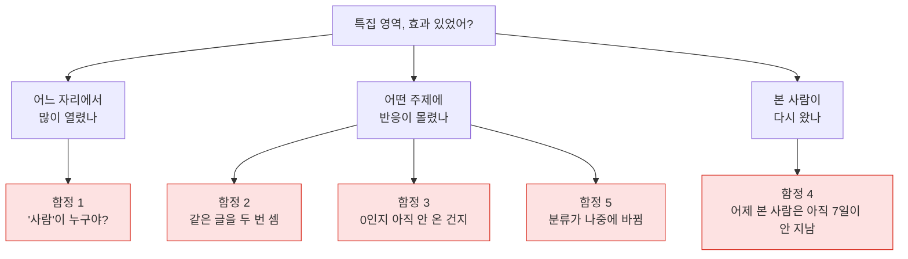
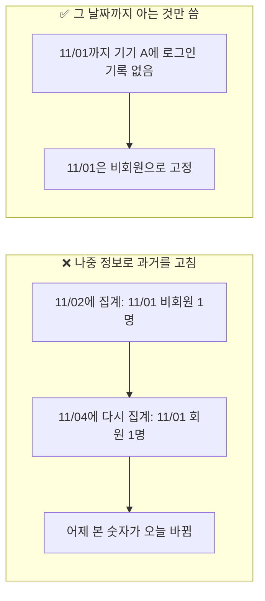
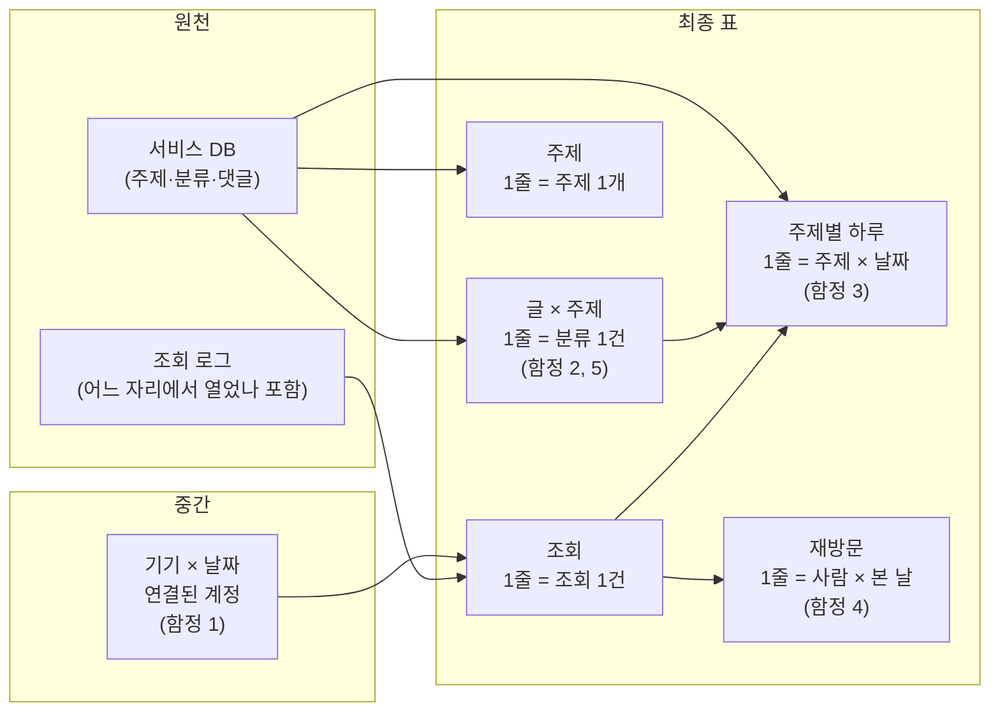

# 숫자 하나 내는데 왜 이렇게 오래 걸렸나 — 지표 정의에서 걸린 함정 5개

> 앞 노트: [데이터 마트 층 구조](17-data-mart-layers.md) · [데이터 오류 감시는 두 층](18-data-quality-monitoring.md)

오늘 받은 질문은 단순했다. **"이번에 띄운 특집 영역, 효과 있었어?"**

데이터는 다 있었다. 조회 로그도 있고, 글 분류도 있고, 댓글도 있다. 그런데 막상 세려고 하니까 "그래서 뭘 어떻게 세는 건데?"에서 계속 막혔다. 막힌 곳이 다섯 군데였다.

## 한 장으로 보기



| # | 걸린 곳 | 그냥 하면 | 그래서 이렇게 |
|---|---|---|---|
| 1 | 사람 세기 | 표마다 회원 수가 다름 | 규칙을 한 곳에 두고 같이 씀 |
| 2 | 주제별 합계 | 합계가 부풀어 오름 | "한 종류만 골라서 더해라"를 적어 둠 |
| 3 | 늦게 온 데이터 | 0이 거짓말함 | 다 도착한 날까지만 보여 줌 |
| 4 | 재방문율 | 최근 날짜만 뚝 떨어짐 | 7일 다 지난 날만 계산 |
| 5 | 분류 변경 | 과거 숫자가 슬쩍 바뀜 | 못 고침. 한계를 적어 둠 |

---

## 함정 1. "조회자 수"에서 사람이 누구야?

로그인 안 하고 본 사람은 기기 ID만 남는다. 같은 사람이 폰으로 로그인 없이 보고, 나중에 로그인하면?

```
기기 A ── 11/01 비로그인 조회
       ── 11/03 로그인 (회원 철수)
```

**11/01 조회는 철수인가?**



정리한 규칙:

1. 이벤트에 회원 ID가 있으면 그 회원
2. 없으면, **그 날까지** 그 기기에 로그인한 계정이 딱 하나면 그 회원
3. 나머지(로그인 기록 없음, 학원 PC처럼 여러 명이 쓴 기기)는 기기 하나를 한 사람으로

함정은 하나 더 있었다. 이 규칙이 이미 **일별 유저 표**에 들어 있었다. 새 표에 그대로 복붙하면 편하지만, 언젠가 한쪽만 고치면 "회원 수"가 표마다 달라진다.

```
❌ 복붙                         ✅ 한 곳으로 빼기

 일별 유저 표   조회 표           [기기×날짜 연결 표] + [판정 macro]
 [규칙 v1]     [규칙 v1 사본]               │
     │              │                ┌──────┴──────┐
 v2로 고침      그대로 v1             일별 유저 표    조회 표
     └─ 숫자 달라짐 ─┘                (항상 같은 규칙)
```

빼낸 뒤에 기존 일별 유저 표의 결과가 **한 줄도 안 바뀌었는지** 확인했다. 계산 위치만 옮긴 거니까 결과가 같아야 맞다.

---

## 함정 2. 같은 글을 두 번 센다

글 하나가 주제 두 개에 걸릴 수 있다. 큰 카테고리 하나, 그 안의 세부 이슈 하나.

```
글 10 (조회 100) ─┬─ 카테고리 "영어"
                  └─ 이슈 "영어 듣기 난이도"
```

주제별 조회 수를 그냥 다 더하면:

| 주제 | 조회 |
|---|---|
| 영어 | 100 |
| 영어 듣기 난이도 | 100 |
| **합계** | **200** ← 실제 조회는 100 |

이건 표를 고쳐서 없앨 수 있는 문제가 아니었다. 글이 두 주제에 속하는 건 사실이니까.

그래서 표는 "글 × 주제" 한 쌍을 한 줄로 그대로 두고, 이 표를 쓰는 사람이 읽는 설명에 이렇게 적었다.

> 카테고리와 이슈를 섞어서 더하지 말 것. 한 종류만 골라서 더한다.

요즘은 사람뿐 아니라 AI 에이전트도 이 설명을 읽고 쿼리를 짠다. 그래서 설명 한 줄이 실제로 잘못된 합계를 막는다.

---

## 함정 3. 0이 진짜 0이 아닐 때

주제별 하루 표는 데이터를 두 군데서 가져온다.

```
조회 ─── 이벤트 로그 ── 다음 날 새벽 도착
댓글 ─── 서비스 DB  ── 하루 한 번 추출
```

어느 날 DB 추출이 늦었다고 해 보자.

```
           조회    댓글
11/20      300     45
11/21      280     38
11/22      310      0   ← 진짜 댓글이 없었나? 아직 안 온 건가?
```

빈칸을 0으로 채우면 이 둘을 구분할 수 없다. 다음 날 아침 이 표를 본 사람은 "어제 반응 없었네"라고 결론 내린다.

해결은 **둘 다 도착한 날까지만 행을 만드는 것**이다.

```
조회 도착   ████████████████████  11/22까지
댓글 도착   ████████████████░░░░  11/21까지
                              ↑
            표에 보여 주는 범위: 11/21까지
```

```sql
-- 시작: 분류가 처음 생긴 날 (그 전엔 '주제별'이라는 말이 의미 없음)
-- 끝: 두 소스 중 더 늦게 끝난 쪽에 맞춤
greatest(첫_조회일, 첫_분류일) as from_date,
least(마지막_조회일, 마지막_댓글일) as to_date
```

이렇게 하면 표 안에 있는 0은 진짜 0이다.

---

## 함정 4. 재방문율은 최근 날짜가 항상 낮다

"본 날 다음 날부터 7일 안에 다시 왔나?"를 날짜별로 그리면 이런 모양이 나온다.

```
재방문율
 40% ┤ ●  ●  ●  ●  ●
 30% ┤                ●
 20% ┤                   ●
 10% ┤                      ●
     └──────────────────────────
      11/10 ...         11/21 11/22
                         ↑ 갑자기 떨어짐?
```

떨어진 게 아니다. 11/22에 본 사람은 아직 7일이 안 지났다. 다시 올 기회가 아직 남아 있다.

```
11/10 본 사람  ▓▓▓▓▓▓▓  창 7일 다 지남 ✅
11/20 본 사람  ▓▓▓░░░░  3일만 지남     ⏳
11/22 본 사람  ▓░░░░░░  1일만 지남     ⏳
               └ 오늘
```

그래서 행마다 "7일 창이 다 찼나"를 표시해 두고, 비율은 **다 찬 행만** 넣어서 계산했다.

정하면서 고민한 것들:

- **같은 날 다시 온 건 안 센다.** 같은 날 다시 온 걸 세면 글 하나 보고 뒤로 가기 한 것도 재방문이 된다. 그래서 다음 날부터 센다.
- **"다 찼나"는 오늘 날짜가 아니라 마지막으로 데이터가 다 들어온 날 기준.** 데이터가 늦은 날엔 7일이 지났어도 그 사이 데이터가 비어 있을 수 있다.
- **재방문은 두 개를 냈다.** 사이트에 다시 왔나, 특집 영역에서 다시 글을 열었나. 뒤의 것은 앞의 것 안에 들어가야 한다. 이걸 테스트로 걸어 뒀다.

이 값은 실제보다 조금 낮게 나온다(하한). 비회원이 창 안에서 처음 로그인하면 다른 사람으로 잡혀 "안 돌아옴"으로 세지기 때문이다.

---

## 함정 5. 분류가 나중에 바뀐다

글 분류 테이블은 이력이 없다. 관리자가 주제를 옮기면 그냥 덮어쓴다.

```
11/15  글 10 → "영어"
11/18  관리자가 옮김 → "국어"      (11/15 기록은 사라짐)
```

그러면 11/16의 조회는 어느 주제로 세야 할까?

| | 지금 분류로 셈 | 그때 분류로 셈 |
|---|---|---|
| 11/16 조회 | 국어 | 영어 |
| 필요한 것 | 지금 테이블만 있으면 됨 | 언제부터 언제까지 어느 주제였는지 기록 |
| 가능? | ✅ | ❌ 기록이 없어서 못 만듦 |

이력을 남기는 방식(SCD Type 2)으로 바꾸면 오늘부터는 쌓을 수 있지만, 지나간 과거는 되살릴 수 없다.

그래서 "이 표의 주제는 지금 기준"이라고 설명에 적어 두었다. 숨긴 한계는 틀린 결론이 되지만, 적어 둔 한계는 그냥 질문의 범위가 된다.

---

## 결과물 모양



---

## 테스트로 박아 둔 것

말로 적어 둔 규칙은 잊히는데, 테스트는 깨지면 빨간불이 켜진다. 그래서 위에서 고민한 경계를 다 테스트로 남겼다.

**로직 테스트** (가짜 입력을 넣고 결과를 비교)

| 넣은 입력 | 기대한 결과 |
|---|---|
| UTC 11/01 16:00 로그인 (= 한국 11/02 01:00) | 11/01엔 아직 비회원 |
| 분류 생기기 전 날의 조회 | 주제별 표에 안 들어감 |
| 댓글만 늦게 온 날 | 그 날은 행이 없음 |
| 같은 날 다시 옴 / 8일째 옴 | 둘 다 재방문 아님 |

**데이터 테스트** (실제 데이터에서 항상 맞아야 하는 관계)

```
특집 영역 조회 수     ≤  전체 조회 수
특집 영역 재방문한 사람 ⊆  사이트 재방문한 사람
세부 이슈             →  상위 카테고리가 반드시 있음
```

---

## 오늘 느낀 것

데이터가 있다고 숫자가 바로 나오는 게 아니었다. "사람이 누구냐", "0이 무슨 뜻이냐", "언제 기준이냐"를 하나씩 정해야 비로소 셀 수 있었다. 그리고 정한 걸 한 곳에 두지 않으면 언젠가 표마다 다른 숫자가 나온다.

---

## 덤: 오늘 같이 배운 작은 것들

| 상황 | 알게 된 것 |
|---|---|
| `git diff --stat`에 이미지가 `4 ++--`로만 나옴 | Git LFS다. 실제 파일 대신 포인터가 커밋된다 |
| Playwright `networkidle`이 계속 타임아웃 | 광고·폴링이 많은 사이트는 네트워크가 안 조용해진다. `load` 후 잠깐 기다리기 |
| 전체 페이지 캡처에 하단 탭바가 중간에 박힘 | 고정(`fixed`/`sticky`) 요소는 캡처 전에 숨기기 |
| 캡처에 그린 라벨이 첫 줄을 가림 | 라벨을 박스 위로 빼기 |
| zsh에서 `set -- $pair`가 안 쪼개짐 | zsh는 변수를 공백으로 안 쪼갠다. `bash -c`로 돌리기 |
| 이미지 용량 한도 초과 | `cwebp -q 78` 정도면 글자 많은 캡처도 잘 읽힌다 |
