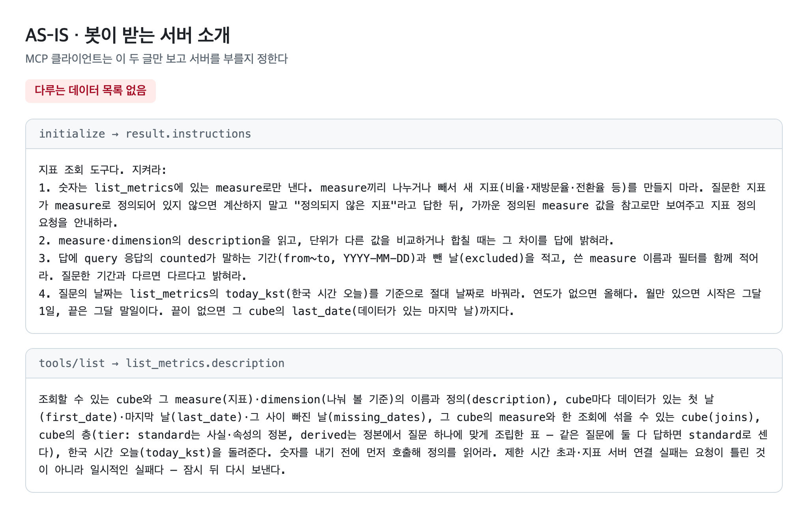
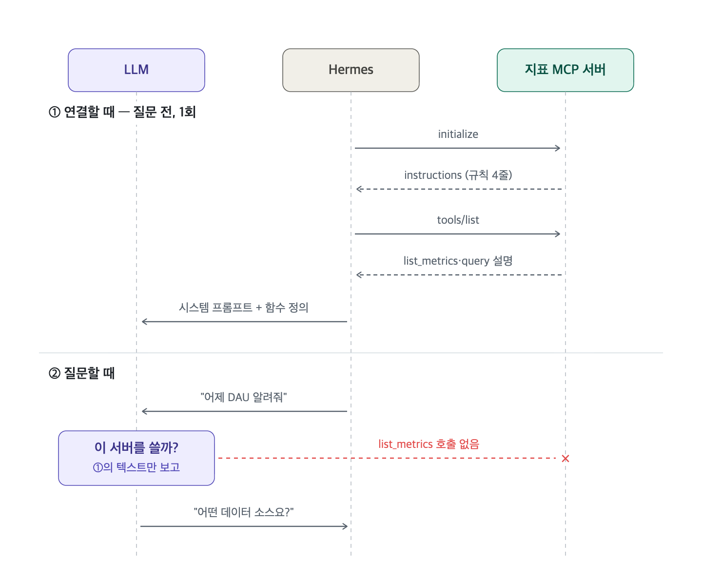
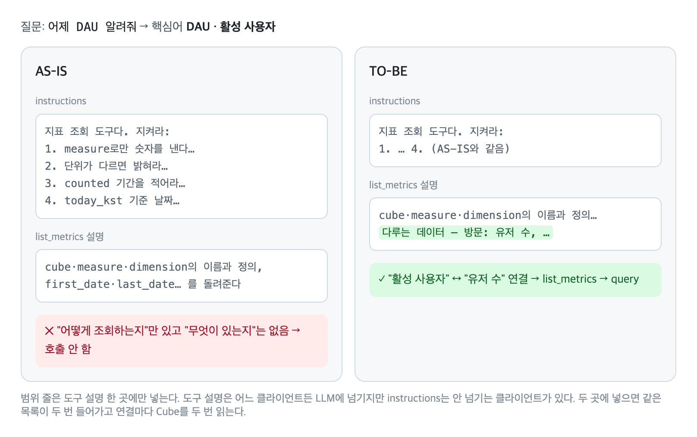

# 지표 봇이 데이터를 못 찾던 문제 — MCP 서버 자기소개 개선

> 2026-11 · 사내 지표 조회 MCP 서버 + Slack 봇(Hermes Agent)
> 관련 TIL: [트러블슈팅 노트](../../2026/11/16-hermes-slack-bot-mcp-troubleshooting.md)

## 한 줄 요약

봇에게 "어제 DAU"를 물으면 **지표 서버를 두고도 "어떤 데이터 소스요?"라고 되물었다.** 원인은 봇이 아니라 서버의 자기소개에 **다루는 데이터 범위**가 없던 것이었다. 서버가 Cube 메타데이터에서 범위를 읽어 자기소개에 싣게 바꿨다.

## AS-IS 서버 소개 글 원문

## 문제 → 원인 → 해결

| 단계 | 내용 |
|---|---|
| 증상 | 지표를 물으면 MCP 도구를 안 부르고 데이터 소스를 되물음 |
| 잘못 짚은 첫 대응 | 봇 쪽 지침(SOUL.md)에 조회 절차를 길게 적음 → 서버 지침과 중복, 문구가 이미 어긋남 |
| 원인 | MCP 클라이언트는 서버의 `instructions`와 도구 `description`만 보고 호출 여부를 정함. 거기에 데이터 범위가 없었음. 지표 정의(Cube description)는 도구를 부른 **뒤에야** 읽힘 |
| 해결 | `tools/list` 요청마다 서버가 Cube `/meta`를 읽어 cube·measure 제목 목록을 `list_metrics` 설명에 붙임 |

## 설계 판단

| 판단 | 이유 |
|---|---|
| 범위를 코드에 고정하지 않고 Cube에서 자동 생성 | 손으로 적으면 지표가 추가·변경될 때마다 낡음 |
| 지표 **이름만** 싣고 정의는 뺌 | 소개 글이 길어지고 정의가 두 곳에 생김 — 정의는 `list_metrics`에서 |
| `list_metrics` 설명 한 곳에만 | 도구 설명은 모든 클라이언트가 LLM에 넘기지만 `instructions`는 안 넘기는 클라이언트도 있음. 두 곳에 실으면 목록이 두 번 들어가고 Cube를 두 번 읽음 |
| Cube 장애 시 범위 없이 예전 소개로 응답 | 서버 소개가 Cube 때문에 실패하면 안 됨 — 경고 로그만 남김 |
| 봇 쪽 지침은 역할만 남김 | 모든 클라이언트가 읽는 곳(서버)에 정보를 둬야 한 곳만 고침 |

**트레이드오프:** `tools/list`마다 Cube 호출이 1회 늘고, 그 호출에 타임아웃이 없음 → Cube가 느리면 도구 목록도 늦게 옴.

## 결과

- 단위·통합 테스트 추가 10개, 변경 3개 (전체 970개 통과)
- 결정 기록(ADR) 작성
